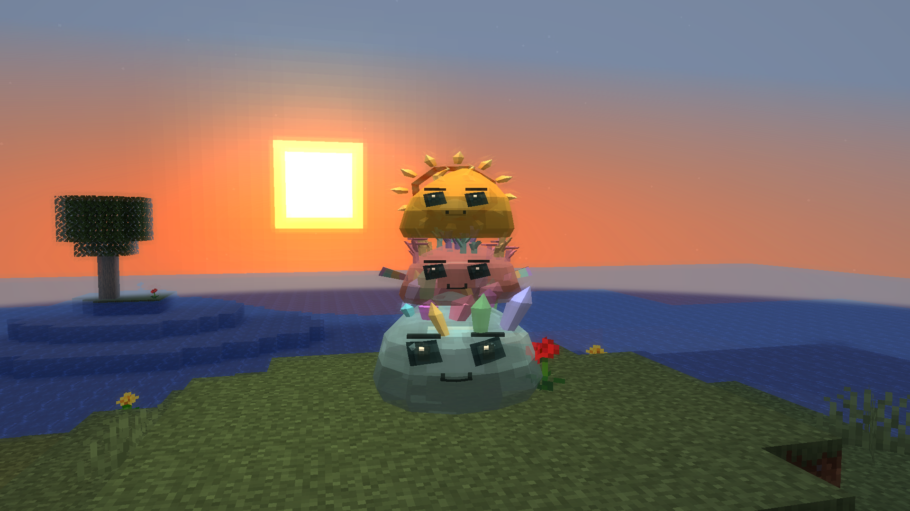
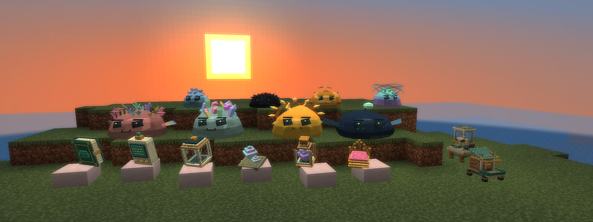

# Slime Evolution — Images and Description

## Cover

[Landscape — 1920×1080](assets/cover/slime-evolution-cover-landscape.png) · [Square — 1080×1080](assets/cover/slime-evolution-cover-square.png)

Real Minecraft capture with the mod's models: Prismatic at the bottom, Coral in the middle, and Solar on top. Capture post-processing adds soft glow, depth haze, and warm color. The square version is cropped from the original.

## Banner

[Original — 2560×960](assets/cover/slime-evolution-banner.png) · [Web — 1920×720](assets/cover/slime-evolution-banner-web.png)

The banner features Coral, Prismatic, Solar, Abyssal, Ice, Ferrofluid, Hive, and Aurora, plus the Slimepedia, analyzer, capsule, Prismatic Shard, Ancestral Essence, crown, Genetic Station, Incubator, and Feeder. All are real in-game elements.

## Short description

Discover 63 slime species, breed unique genetic lineages, unlock evolutions, train helpful companions, and challenge four bosses in a SolarPunk-inspired world.

## Full description

**A world of slimes to discover, care for, and evolve.**

Slime Evolution brings 63 species with distinct appearances, habitats, behaviors, and abilities. Find elemental creatures and discover rare lineages through breeding and metamorphosis.

Every slime has its own genetics. Combine individuals, follow inherited traits, and explore new possibilities each generation. Learn diets, meet their needs, and develop a bond through care and training.

Your slimes can also help with everyday tasks. Nineteen individual jobs cover item transport, irrigation, lighting, repairs, redstone circuits, mineral detection, and more. Certain species cooperate through symbiosis.

Explore natural structures, prepare rituals, and challenge four bosses in dedicated arenas. Use the Slimepedia and research equipment to record discoveries and reach advanced lineages.

Custom GeckoLib models and animations meet SolarPunk-inspired equipment and interfaces, combining nature, research, and technology.

**Choose your companions and discover how far the next generation can go.**

## Compatibility

Minecraft Java **1.21.1**, NeoForge **21.1.264**, and Java **21**. Requires **GeckoLib 4.9.3** on both client and server. The cover's capture shader is not needed to play.

[New in 0.24.0: expanded lineages](guides/EXPANDED_LINEAGES.md).
