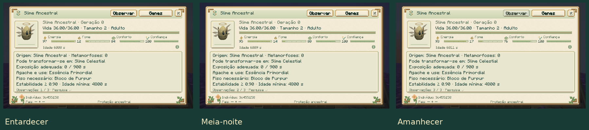

# Cinco linhagens de conquista

[Guia do mod](../README.md) · [Evolução](EVOLUTION.md) · [Genética](../reference/GENETICS.md)

Eclipse, Supercélula, Aurora, Ancestral e Celestial exigem uma preparação
própria, além dos requisitos normais de cuidado, genes e reprodução ou
metamorfose. O analisador mostra o progresso do indivíduo na aba **Evolução**.
Os marcos ficam salvos no slime e acompanham a cápsula.

| Forma | Preparação adicional |
|---|---|
| Eclipse | Solar carregado por 30 segundos de sol e Lunar de Lua Nova; reprodução ao entardecer, com Estilhaço Prismático no inventário do cuidador. |
| Supercélula | Tempestade recebe três cargas de raios distintos conduzidos por um para-raios próximo. |
| Aurora | Prismático passa 30 segundos em cada um de três biomas diferentes; conclusão em noite limpa na região gelada apropriada. |
| Ancestral | Vazio usa Selo Primordial, fabricado com troféus de três bosses, Estrela do Nether e Tabuleta Antiga do End. |
| Celestial | Ancestral com confiança 80, pesquisa completa da espécie e três observações astronômicas, em ordem. |

## Eclipse: preparar os dois pais

Mantenha um Solar adulto, calmo e vinculado, com confiança mínima 40, sob céu
aberto durante o dia, sem chuva. Ele acumula 600 ticks de exposição solar
válida, aproximadamente 30 segundos carregado. A carga não desaparece ao
recolher o slime; a exposição para de avançar na cápsula.

Escolha um Lunar cuja fase individual seja **Lua Nova**. A fase é definida
para cada indivíduo; esperar a lua do mundo mudar não altera esse Lunar.
Prepare os dois pais para reprodução normalmente. Ambos precisam estar sob
céu aberto entre os ticks **12.000 e 12.999** do dia. O mesmo cuidador deve
estar próximo, com visão dos pais e um **Estilhaço Prismático no inventário**.

Só um nascimento aceito consome o estilhaço e a carga solar. Não é necessário
jogar o item no chão. Cruzar dois Eclipses continua exigindo o entardecer,
céu aberto, cuidador presente e catalisador; isso evita contornar o ritual
multiplicando o primeiro casal.

## Supercélula: conduzir a tempestade

Um Tempestade adulto vinculado, com confiança mínima 40, precisa ficar até
oito blocos do raio que atinge um **para-raios energizado**, durante uma
tempestade com trovões. São três raios diferentes; os flashes repetidos do
mesmo raio contam uma única vez. Raios normais ou invocados seguem essa
mesma verificação do para-raios e do clima.

Com três cargas, cumpra a metamorfose: para-raios como substrato, Picos
Ventosos ou Picos Pedregosos Ventosos, trovões, céu aberto, idade 96.000,
potência elemental expressa ≥0,90 e 12.000 ticks de exposição válida.
Use uma carga de vento; o custo é 40 de energia e +25 de fome.

## Aurora: viajar com o Prismático

Leve o mesmo Prismático adulto vinculado, calmo e com confiança mínima 40,
a três biomas de IDs diferentes. Cada visita exige 600 ticks válidos,
aproximadamente 30 segundos carregado. A visita em andamento reinicia ao
mudar de bioma; as visitas já concluídas permanecem registradas.

Depois, conclua em Picos Congelados ou Espigões de Gelo, sobre gelo azul,
à noite, sem chuva e sob céu aberto. Ainda são necessários idade 96.000,
estabilidade expressa ≥0,90 e 12.000 ticks de exposição válida.
Use um Estilhaço Prismático; o custo é 40 de energia e +25 de fome.

## Ancestral: conquistar o Selo

Fabrique um **Selo Primordial** com uma unidade de cada componente:
Geleia Real, Fragmento Ígneo, Estilhaço Prismático, Estrela do Nether e
Tabuleta Antiga. Os três primeiros vêm do Rei, Coração Magmático e Colosso;
a tabuleta exige explorar a Câmara Ancestral no End. A receita não usa
Essência Ancestral, permitindo obter o primeiro Ancestral sem depender dele.

Leve o Vazio adulto às Terras Altas do End, sobre púrpura. Precisa de idade
48.000, estabilidade expressa ≥0,80 e 12.000 ticks de exposição válida.
Use o Selo no slime; custa 40 de energia e +30 de fome. Usar outro Selo no
altar da Câmara inicia o encontro com o boss Primordial, um uso separado.

## Celestial: vínculo, pesquisa e observações

Conclua as seis etapas de pesquisa do **Ancestral** na Slimepedia do cuidador:
observar, alimentar, analisar, reproduzir, transformar e coletar material. Alcance
confiança 80 com o indivíduo escolhido.

No Overworld, coloque esse Ancestral adulto e calmo sobre um bloco de
ametista, sob céu aberto e sem chuva. Com energia mínima 60, abra seu
analisador e clique em **Observar**, nesta ordem:

| Observação | Horário do mundo, módulo 24.000 |
|---|---|
| Entardecer | 12.000–12.999 |
| Meia-noite | 17.500–18.499 |
| Amanhecer | 23.000–23.999 |

Cada confirmação custa quatro de energia e acrescenta dois de fome.
Clicar novamente na mesma janela não avança a observação seguinte.
Não é necessário fazer as três no mesmo dia. Uma prévia de cápsula permite
consultar informações, mas não realizar observações.

Após as três observações, conclua a metamorfose nas Terras Altas do End,
sobre púrpura: idade 96.000, estabilidade expressa ≥0,90 e 18.000 ticks de
exposição válida. Use uma Essência Primordial; custa 50 de energia e +35 de fome.
