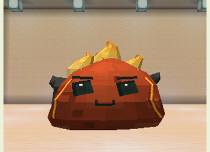
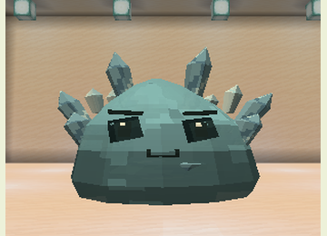
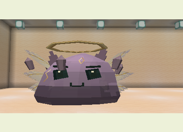

# Bosses and Minions

Find one of the four [natural arenas](SPECIAL_STRUCTURES.md) and use its ritual item on the central altar. Accepted rituals consume the item and reserve the altar until the boss dies. The arena needs 17×17 floor space and six clear blocks above.

Difficulty must be above Peaceful, with no liquids, sufficient space, and no other loaded living boss within 96 blocks. Ground warnings, body pulses, and sounds signal attacks.

## Gelatinous King

**Health: 290 · Armor: 7 · Phases: 2 · Reward: 2 Royal Gel**

Craft a Gelatinous Crown with a Slime Core, Breeding Gel, and four gold ingots. Use it at the Royal Court altar in the Overworld.

The King alternates jump impacts, summons, crosses, and rings. Hits apply Slowness I and launch targets. Phase two begins at half health and remains active even if healed.

| Minion | Role |
|---|---|
| Guard | Melee attacker; applies Weakness II |
| Healer | Restores nine King health per pulse, requiring range and line of sight |
| Spitter | Ranged attacker; applies Slowness I and Poison I |

The King maintains up to six minions. Prioritize healers to limit recovery.

## Magmatic Heart

**Health: 320 · Armor: 6 · Phases: 2 · Reward: 2 Igneous Fragments**

Craft a Magma Brazier with a Slime Core, Elemental Essence, two magma creams, and two blaze powders. Use the Elemental Sanctuary altar.

Attacks include rings, eruptions, crosses, and twin eruptions. Hits ignite and apply Hunger II. Phase two begins at half health; water reduces damage. Up to four fire or magma servants provide ranged embers and pursuing bombs. Bomb explosions apply Blindness I and Hunger II without destroying terrain.

## Crystalline Colossus

**Health: 400 · Armor: 10 · Phases: 2 · Reward: 2 Prismatic Shards**

Craft a Crystal Sigil with a Slime Core, two Crystal Fragments, two amethyst shards, and a diamond. Use the Crystal Cavern altar.

Shard barrages, waves, crosses, and rings apply Slowness III and Mining Fatigue II. Phase two starts at half health. Defense increases while preparing an attack; exploit recovery windows.

## Primordial Slime

**Health: 540 · Armor: 8 · Phases: 3 · Reward: 2 Primordial Essences**

Craft a Primordial Seal with Royal Gel, Igneous Fragment, Prismatic Shard, Nether Star, and Ancient Tablet. Use the Ancestral Chamber altar in the End; the chamber supplies the tablet.

Attacks include waves, fire rings, shards, crosses, and orbital rupture. Hits apply Weakness I and Wither I; shards and orbital attacks also apply Levitation I. Phases change at two-thirds and one-third health. Up to three flying Ancestral Echoes attack at close range.

## Preparation and rewards

The interiors of rings, crosses, and orbital attacks also deal damage. Use distance beyond the outline, elevation, or cover as appropriate. Later phases increase damage, while an attack already being prepared retains its initial parameters.

Rewards require a player-credited victory. Minions provide no rewards. Boss trophies support equipment, incubation, and [rare metamorphoses](ADVANCED_LINEAGES.md). See [balance values](../BALANCE.md).
