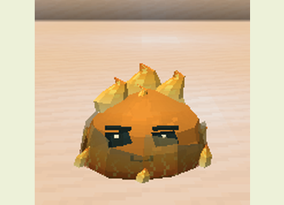
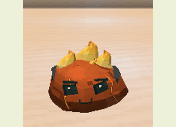
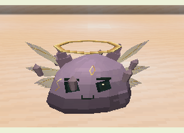

# Bosses e lacaios

[Guia do mod](../README.md) · [Estruturas](SPECIAL_STRUCTURES.md) · [Balanceamento](../BALANCE.md)

Encontre uma das quatro [arenas naturais](SPECIAL_STRUCTURES.md) e use seu
item de ritual no altar central correspondente. A estrutura nasce sem boss,
com piso de 17×17 e seis blocos livres. O item é consumido somente quando a
invocação é aceita; o altar fica ocupado até a morte do boss e pode ser
reutilizado. As arenas são protegidas contra alterações dos jogadores.

A dificuldade precisa estar acima de Pacífica. O local deve ter espaço livre,
sem líquidos ou outro boss vivo carregado em 96 blocos. Os sinais no chão,
a pulsação do corpo e os sons indicam a preparação dos golpes.

## Rei Gelatinoso

**Vida:** 290 · **Armadura:** 7 · **Fases:** duas · **Recompensa:** duas Geleias Reais.

Fabrique uma **Coroa Gelatinosa** com Núcleo de Slime, geleia reprodutiva e
quatro barras de ouro. Use-a no altar da Corte Real, no Overworld.

O Rei alterna impacto após salto, invocação de lacaios, cruz e anel.
Seus golpes aplicam Lentidão I e arremessam o alvo para cima. A segunda fase
começa na metade da vida e permanece mesmo que ele seja curado.

| Lacaio | Aparência | Função |
|---|---|---|
| Guarda |  | Aproxima-se e luta corpo a corpo; aplica Fraqueza II. |
| Curandeiro |  | Recupera nove pontos de vida do Rei por pulso, com alcance e visão livre. |
| Cuspidor |  | Ataca de longe e aplica Lentidão I e Veneno I. |

O Rei mantém até seis lacaios. Priorize os curandeiros para reduzir sua recuperação.

## Coração Magmático

**Vida:** 320 · **Armadura:** 6 · **Fases:** duas · **Recompensa:** dois Fragmentos Ígneos.

Fabrique um **Braseiro Magmático** com Núcleo de Slime, Essência Elemental,
dois cremes de magma e dois pós de blaze. Use-o no altar do Santuário Elemental.

Alterna anel, erupção, cruz e erupções gêmeas. Seus golpes incendeiam e aplicam
Fome II. A segunda fase começa na metade da vida; água reduz seu dano.

| Lacaio | Aparência | Função |
|---|---|---|
| Cuspidor de Fogo |  | Mantém distância e lança brasas. |
| Slime Bomba de Magma |  | Persegue, acende um pavio e explode, causando Cegueira I e Fome II. |

O Coração mantém até quatro lacaios. Afaste-se da bomba quando ela começar
a pulsar. A explosão atinge alvos próximos sem destruir o terreno.

## Colosso Cristalino

**Vida:** 400 · **Armadura:** 10 · **Fases:** duas · **Recompensa:** dois Estilhaços Prismáticos.

Fabrique um **Sigilo Cristalino** com Núcleo de Slime, dois Fragmentos Cristalinos,
dois fragmentos de ametista e um diamante. Use-o no altar da Caverna Cristalina.

Alterna barragens de estilhaços, onda, cruz e anel. Aplica Lentidão III e
Fadiga de Mineração II. A segunda fase começa na metade da vida. Durante a
preparação ele reforça a defesa; aproveite a recuperação para atacar.

## Slime Primordial

**Vida:** 540 · **Armadura:** 8 · **Fases:** três · **Recompensa:** duas Essências Primordiais.

Fabrique um **Selo Primordial** com Geleia Real, Fragmento Ígneo, Estilhaço
Prismático, Estrela do Nether e Tabuleta Antiga. Use-o no altar da
Câmara Ancestral no End. Essa câmara também fornece a tabuleta.

Alterna onda, anel de fogo, estilhaços, cruz e ruptura orbital. Seus golpes
aplicam Fraqueza I e Wither I; estilhaços e orbital também aplicam Levitação I.
As fases mudam em dois terços e um terço da vida.

Invoca até três **Ecos Ancestrais**, versões menores que voam e atacam de perto.

## Preparação e recompensas

Os interiores dos anéis, cruzes e rupturas orbitais também causam dano.
Use distância além do contorno, altura ou cobertura conforme o ataque.
Fases aumentam o dano, e a preparação de um golpe conserva seus parâmetros
até terminar. Os valores exatos estão em [balanceamento](../BALANCE.md).

As recompensas exigem vitória com crédito de jogador. Lacaios não deixam
recompensas. Troféus permitem fabricar equipamentos, melhorar a incubação e
alcançar as [metamorfoses avançadas](ADVANCED_LINEAGES.md).
