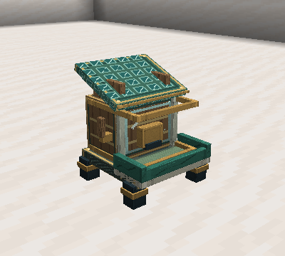
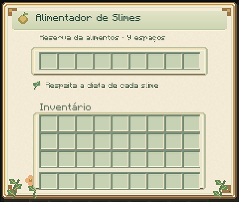

# Cuidado e captura

[Guia do mod](../README.md) · [Dietas das espécies](SLIMES.md) · [Reprodução](BREEDING.md)

## Alimentação e necessidades

Use diretamente no slime um alimento de sua [dieta](SLIMES.md). Uma refeição
aceita consome um item em sobrevivência, reduz 20 de fome e recupera dez de
energia. Ele precisa ter pelo menos 20 de fome e aguardar cinco segundos
entre refeições.

Agache e interaja com a mão vazia para consultar as necessidades. Os valores
vão de zero a 100: fome baixa é boa; energia, conforto e confiança altos são bons.
Fome e recuperação de energia dependem do metabolismo e das condições do recinto.

## Cuidador e confiança

O primeiro jogador que alimenta manualmente o slime se torna seu cuidador.
Outros jogadores podem alimentá-lo, mas o vínculo e a confiança continuam
pertencendo ao cuidador.

| Temperamento | Confiança por refeição do cuidador | Mínimo para capturar |
|---|---:|---:|
| Dócil | 20 | 20 |
| Neutro | 15 | 40 |
| Hostil | 10 | 70 |

Hostis deixam de selecionar o cuidador como alvo a partir de 20 de confiança.
Ferir o próprio slime reduz 20 de confiança e pode provocar retaliação.
O vínculo permite cuidado e captura. Com treinamento, o cuidador também pode
ensinar ordens e organizar parceiros de trabalho. Veja [vínculo e simbiose](COMPANIONS.md).

## Recinto

Escolha piso e ambiente adequados à espécie. Bioma preferido, piso adequado,
umidade e quantidade de vizinhos influenciam o conforto. Evite superlotação;
Fogo sofre na água e Gelo é vulnerável ao fogo.

Use barreiras que contenham os saltos e feche o teto quando necessário.
As tags de habitat podem ser ajustadas por [datapacks](../reference/SPECIES_DATA.md).

## Alimentador

O reservatório e a bandeja frontal ficam voltados para você ao colocar o bloco.

O alimentador tem **nove espaços** e aceita funis. A cada dois segundos,
tenta alimentar um slime faminto com visão livre dentro de quatro blocos.
Consome apenas alimentos compatíveis e respeita a recarga individual de refeição.

Ele mantém a alimentação, mas não cria cuidador nem aumenta confiança.
Conquiste o vínculo manualmente antes de automatizar o recinto.

## Cápsula

Use uma cápsula vazia em um slime de **tamanho 1 ou 2**, com:

- Confiança suficiente no cuidador.
- Pelo menos metade da vida e dez de energia.
- Ausência de combate ou dano recente por cinco segundos.
- Espaço livre de montarias, passageiros ou laços.

Somente o cuidador pode capturar e liberar. Use a cápsula ocupada sobre um
piso sólido, com espaço livre e seco. Uma liberação recusada mantém o slime
na cápsula. Chefes e lacaios não podem ser capturados.

A cápsula preserva identidade, genes, vida, idade, confiança e recargas.
O indivíduo fica suspenso enquanto está dentro dela. Guarde os itens ocupados
com cuidado: perdê-los torna o indivíduo inacessível pelo fluxo normal.

Capturas pertencem ao mundo em que foram feitas. Ao fazer backup, preserve o
mundo inteiro, incluindo inventários e registros de captura. Veja
[instalação e backup](../INSTALLATION.md).

## Receitas

As receitas ficam no livro após obter uma bola de slime. Há uma rota de
cápsula com **um Núcleo de Slime e um vidro**, além da receita inicial.
[Materiais e receitas](MATERIALS.md).
