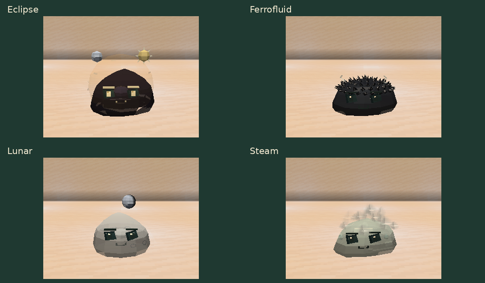
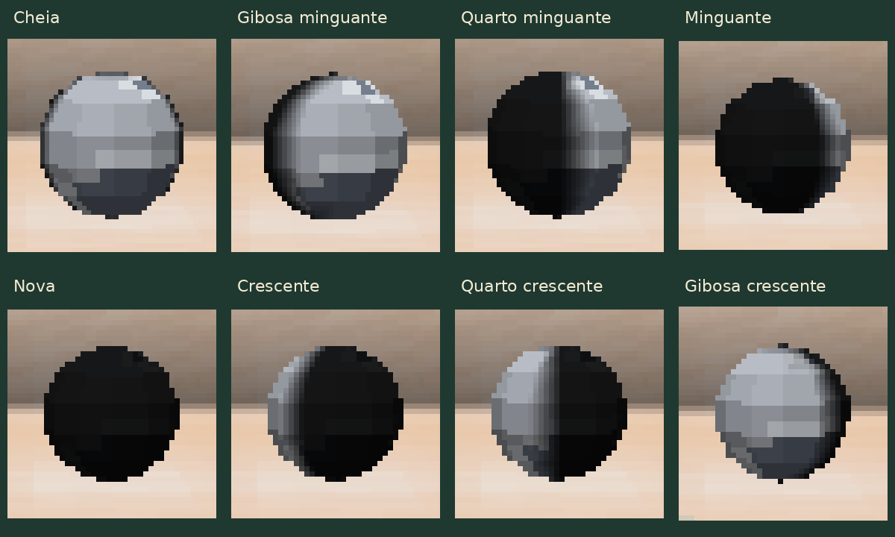

# Aparências e fases lunares

[Guia do mod](../README.md) · [Galeria das espécies](SLIMES.md)

O **Eclipse** tem uma aura esférica e dois astros que orbitam acima do corpo.
O **Ferrofluid** tem uma cobertura de espinhos pequenos na cabeça.
O **Steam** solta fumaça pela coroa, ombros e laterais; as nuvens sobem e se dissipam.



## As oito luas do Lunar

Cada Lunar nasce com uma das oito fases. Sua lua flutua acima da cabeça,
faz uma pequena órbita e conserva a fase quando o mundo é salvo ou quando
o slime é transportado em cápsula. A fase é apenas visual e não acompanha
o calendário do mundo.

Os recortes abaixo mostram em detalhe a lua flutuante de cada variante.



| Valor | Fase |
|---|---|
| 0 | Cheia |
| 1 | Gibosa minguante |
| 2 | Quarto minguante |
| 3 | Lua minguante |
| 4 | Nova |
| 5 | Lua crescente |
| 6 | Quarto crescente |
| 7 | Gibosa crescente |

## Invocar para comparar

Com comandos habilitados, este exemplo cria um Lunar com fase própria:

```mcfunction
/summon slimeevolution:evolution_slime ~ ~ ~ {Species:"slimeevolution:lunar"}
```

Para escolher a fase, acrescente `LunarPhase` de 0 a 7. Por exemplo, lua nova:

```mcfunction
/summon slimeevolution:evolution_slime ~ ~ ~ {Species:"slimeevolution:lunar",LunarPhase:4}
```

Os outros três IDs de espécie são `slimeevolution:eclipse`,
`slimeevolution:ferrofluid` e `slimeevolution:steam`; substitua o valor de
`Species` no primeiro comando.
