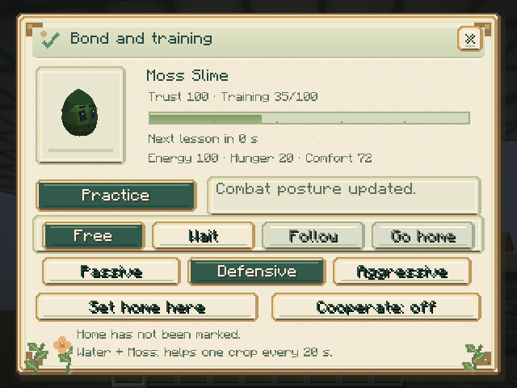

# Companions, Levels, and Symbiosis

## Open the companion panel

Manually feed a slime to become its caretaker. Then **crouch and use the Genetic Analyzer on your slime**. Normal analyzer use still opens genetic inspection. Control requires a nearby caretaker, clear line of sight, and building permission.

## Levels and commands

[Levels 1–10](LEVELS.md) replace practice lessons. Eating a suitable food grants 2 XP; kills grant 8 XP for passive mobs, 20 for hostiles, and 160 for bosses. Each level improves health, armor, and damage without changing genes.

| Command | Minimum level | Behavior |
|---|---:|---|
| Free | 1 | Resume natural movement and feeding |
| Wait | 1 | Hold the current position |
| Follow | 1 | Follow the caretaker in the same dimension |
| Return home | 1 | Return to the marked home and wait |

Commands require 40 trust; Free remains available below that value. Mark a home before returning. Feed bags can feed slimes in Follow.

Follow uses faster hops and more frequent path updates outside combat, helping slower species keep up. Ancestral and Celestial fly in a small formation while following; they use collision-aware air navigation and return to ground movement when the order ends or combat interrupts it. All mod slime species are immune to fall damage, including wild individuals and those without wings. Bonded slimes also reject damage and harmful effects attributed to their own caretaker; see [care and capture](CARE.md).

A loaded follower **more than 32 blocks away** can teleport to a safe, dry, supported point near its caretaker in the **same dimension**. Attempts run at most once per loaded second, with a five-second cooldown after success. It checks space for the whole slime, hazards, and the world border. No teleport occurs during combat, recent attacks, defeat, immobilization, riding, or leashing. If there is no safe point, it continues trying to follow normally. No chunks are forced to load, and other dimensions or an unavailable caretaker do not trigger a teleport.

Energy limits special skills rather than learned movement or basic attacks. Even at zero energy, companions can follow, fly, and reacquire hostiles in Aggressive. Ranged attackers that cannot afford their next skill approach for a basic melee attack. Feed and care for the team so its special skills recover; the five-follower limit remains shared across dimensions.

## Defeated companions

A bonded slime that takes lethal ordinary damage enters a **defeated state for 10 loaded seconds**, with three stars orbiting above its head. It remains in place, stops attacking, casting, flying, and working, and cannot be captured during recovery. Enemies cannot damage it further during this period, and boss minions switch to other targets.

It then gets up with **50% health**, at least 20 energy, and **two seconds of protection** against immediate defeat. Its identity, genes, trust, level, XP, commands, follower reservation, and stored belongings remain intact. No loot, experience, or duplicate slime is created. Existing skill recoveries continue normally.

The timer is saved and pauses while unloaded. Wild slimes retain normal death. Administrative removal and damage that bypasses invulnerability, including the void, keep their normal behavior.

## Combat postures

Choose a combat posture independently of Free, Wait, Follow, and Return home:

| Posture | Behavior |
|---|---|
| Passive | Does not automatically attack or retaliate, even if the caretaker or slime is hit. |
| Defensive | Default for new and existing individuals. Defends itself and its caretaker and assists against the caretaker's recent attack target. |
| Aggressive | Includes Defensive behavior and seeks visible hostile mobs within a spherical 16-block radius. |

Automatic basic combat requires adulthood and at least 40 trust. Special skills require their listed energy cost. Passive remains selectable at low trust. It also prevents offensive ability effects; supportive abilities and ordinary care remain available.

The caretaker, bonded slimes, tame animals, allies, spectators, Creative players, and PvP-protected players are not valid targets. Priority goes to the caretaker's recent attacker, then the slime's attacker, then the caretaker's recent victim. Combat records expire after 200 ticks, normally ten seconds. Targets are rechecked for range, sight, and eligibility; movement orders resume after combat.

Waiting guards stay within eight blocks of their anchor. Followers do not pursue targets farther than 32 blocks from their caretaker, in addition to their local 16-block combat range. Return home can pause for local combat, bounded to 16 blocks from its starting point; the return resumes afterward.

Postures persist through saves, capsules, and metamorphoses. Offspring start Defensive rather than inheriting their parents' selected posture.

## Five followers per caretaker

At most **five slimes may be in Follow for one caretaker across the whole world**, including all dimensions. A sixth request is rejected without changing the previous order. Hover over Follow for the reserved follower count.

Unloaded slimes keep their reserved slot. Free, Wait, Return home, capture, or removal releases it. Releasing a captured follower restores Follow if there is room; with five occupied slots, the released slime switches to Wait at its release location, keeping its posture, level, and XP.

Old worlds with more than five followers move excess individuals to Wait as they load. Reservations are stored in `data/slimeevolution_followers.dat`; include it in complete world backups.

## Mark a home

**Mark home here** uses the caretaker's current position. Choose solid, dry ground inside the world border with room for the entire slime. A home can be marked before learning Return home. Return requires the same dimension and a loaded, unblocked location.

## Enable symbiosis

Open each partner's panel and enable cooperation. Both must be adults with the **same caretaker**, within six blocks and mutual line of sight, calm, with trust ≥40, energy ≥30, hunger ≤60, and comfort ≥40. Recent damage, breeding, leashes, mounts, or passengers prevent cooperation.

Partners cooperate while Free or Waiting. Follow and Return home suspend work. Cooperation starts disabled for new and existing individuals.

| Partners | Work | Cost per participant | Shared recovery |
|---|---|---|---|
| Water + Moss | Advance one compatible crop by one growth stage | 6 energy, +3 hunger | 400 ticks / 20 seconds |
| Electric + Iron | Add up to four processing ticks to a station or incubator | 2 energy, +1 hunger | 20 ticks / 1 second |

No valid work means no charge. Both participants receive recovery, preventing immediate reuse in another pair.

### Water + Moss

Keep partners within four blocks of crops and clear line of sight. Wheat, carrots, potatoes, beetroot, and other compatible `CropBlock` plants are supported. Cooperation does not plant or harvest. The caretaker must be online in the same dimension with permission to alter the location. Work respects `mobGriefing` and NeoForge protection events.

### Electric + Iron

Keep partners within four blocks of the machine, with clear line of sight. The capsule must belong to their caretaker. Assistance occurs only after the machine accepts a valid processing tick; it reduces processing time without bypassing ingredients or changing results, genes, growth rewards, identities, or token rules.

## Persistence and settings

Level, XP, commands, home, cooperation preferences, and recovery persist through saves, capsules, and metamorphoses. Recovery pauses while captured or unloaded. Offspring start at level 1 with no XP and do not inherit commands or homes.

Server options `companions.training` and `companions.symbiosis` can pause these features without deleting progress. Canceling commands and disabling cooperation remain available. See [individual jobs](SPECIALIZATIONS.md).

## Skills and team roles

All 47 companion species now have tiered attacks or support skills. See the [complete combat catalog](COMPANION_COMBAT.md) for roles, costs, cooldowns, combos, and boss team suggestions.

## Carry food for your team

The [Royal and Magmatic Feed Bags](FEED_BAGS.md) store five or fifteen food stacks. Carry one to automatically feed only your own following slimes within sixteen blocks.
