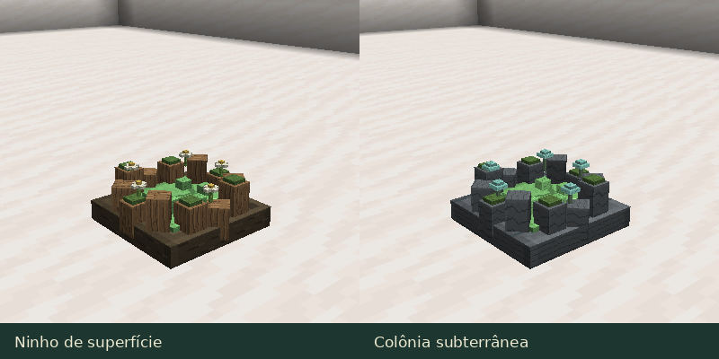

# Ecossistema e habitats

[Guia do mod](../README.md) · [Galeria de espécies](SLIMES.md) · [Estruturas](SPECIAL_STRUCTURES.md)

## Encontrar slimes

As 21 espécies naturais aparecem nos ambientes definidos para cada uma, no
escuro e fora da dificuldade Pacífica. Espaço e limite de população também
influenciam a aparição. As outras 26 formas são obtidas por reprodução ou
metamorfose e estão identificadas na [galeria](SLIMES.md#híbridos-e-metamorfoses).

| Ambiente | Exemplos de espécies naturais |
|---|---|
| Planícies e florestas | Comum, Musgo e Vento |
| Pântanos e manguezais | Lama e Venenoso |
| Campos de cogumelos | Fúngico |
| Rios e praias | Água |
| Regiões geladas | Gelo |
| Desertos | Areia |
| Cavernas e regiões minerais | Pedra, Ferro, Ametista, Obsidiana e Luminoso |
| Nether | Fogo, Magma e Almas |
| End | Slime do End e Vazio |

Biomas específicos e permissões podem ser alterados por
[datapacks](../reference/SPECIES_DATA.md). A Slimepedia registra onde você
observou um indivíduo, inclusive em cativeiro.

## Comida e grupos

Slimes famintos procuram alimentos soltos de sua dieta. Eles consomem itens
próximos com visão livre, respeitando as condições de refeição. Isso não cria
vínculo nem confiança; alimente manualmente para se tornar cuidador.

Espécies sociais se aproximam de indivíduos calmos da mesma espécie e cuidador.
A sociabilidade genética ajusta essa tendência. Espécies territoriais defendem
o entorno do lar; vincular o slime a um cuidador encerra essa defesa territorial.
Combate, fome e descanso alteram as prioridades de movimento.

## Ninhos e colônias

Na superfície, procure raízes, musgo e flores ao redor do gel. Nas cavernas,
pedras e pequenos fungos luminosos identificam as colônias.

Ninhos de superfície e colônias subterrâneas introduzem grupos limitados de
fundadores. Há variações para ambientes do Overworld e do Nether.
A presença desses locais não cria uma fonte infinita de slimes.

A frequência e os limites podem ser ajustados nas [configurações](../CONFIGURATION.md).
As [estruturas especiais](SPECIAL_STRUCTURES.md) formam outra parte da exploração,
com materiais e locais apropriados para rituais.

## Criar um habitat

Ofereça piso e bioma preferidos, espaço para saltos, alimento e pouca
superlotação. O conforto afeta a recuperação e a reprodução. Mantenha espécies
sensíveis à água ou ao fogo em recintos adequados.
[Cuidado e captura](CARE.md).
