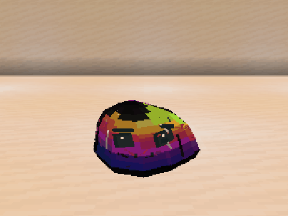
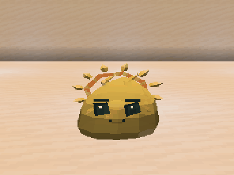

# Elemental Materials and Details

## Corrupted

A dark coating covers the body with smoothly moving iridescent patches. Red, pink, white, and black fissures remain over the surface, following the gel's movement.

## Lunar

Twenty craters cover its top, sides, and back, each with a pale rim and recessed shaded center. Eyes and mouth remain clear. Its floating moon preserves the individual's phase. See [all eight phases and commands](CELESTIAL_VISUALS.md).

## Solar

Rays and corona complete a rotation in **9.6 seconds**. Individual rays pulse on separate timings while the warm corona texture ripples. Upper flames continue following the body.

GIFs use four real frames of the same individual, ten ticks apart, displayed for half a second each. Reduced motion stops the additional decorative movements.
