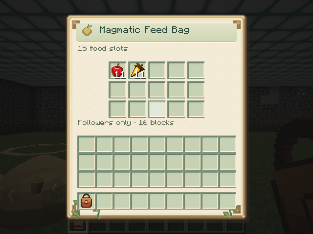

# Feed Bags

[Player guide](../README.md) · [Care and capture](CARE.md) · [Companions](COMPANIONS.md) · [Species and diets](SLIMES.md)

Carry slime food in a dedicated bag to automatically feed your own companions in **Follow**, within a **sixteen-block sphere** around you in the same dimension. Use the bag to open its inventory. It works from your main inventory, hotbar, or offhand; a bag left in a chest or dropped on the ground does not feed slimes.



## Royal Feed Bag — five slots

Craft with **one Royal Gel** from the Gelatinous King, **three Leather**, and **two String**:

```text
S . S
L G L
. L .
```

`S` = String, `L` = Leather, `G` = Royal Gel, `.` = empty. This produces one Royal Feed Bag with **five slots**, each using the food's normal stack limit.

## Magmatic Feed Bag — fifteen slots

Combine **one Royal Feed Bag** with **one Igneous Fragment** from the Magmatic Heart in a crafting grid. Their positions do not matter. The upgrade consumes both ingredients and creates one Magmatic Feed Bag with **fifteen slots**. Its existing food, slot positions, and custom name are preserved.

## What goes inside

The bag accepts items used in at least one slime species' diet, including items such as minerals that players cannot eat. Each follower still eats only its own [species diet](SLIMES.md). For example, an Ancestral accepts Golden Carrots or Glistering Melon Slices, not Apples. Bags and other item containers cannot be nested inside it.

## Automatic meals

Once per loaded second, the bag checks your loaded, living followers inside sixteen blocks, prioritizing the hungriest. It skips other players' slimes, wild slimes, Free/Wait/Return home, defeated individuals, and slimes that are not hungry. Follow must remain enabled and the slime must retain the trust required to obey its command.

A successful meal consumes **one compatible item**, reduces hunger by **20**, restores **10 energy**, and starts the slime's normal **five-second meal cooldown**. It does not assign a caretaker or increase trust. Multiple bags cannot bypass the individual cooldown.

Contents stay on the bag item when you close it, transfer it, save the world, or upgrade it. Automatic feeding also works while the bag is open, with the visible item counts updating normally.

Energy is required for special skills and jobs. It no longer freezes learned movement or basic combat: hungry followers can still follow and respond to their combat posture while waiting for food and skill recovery.
