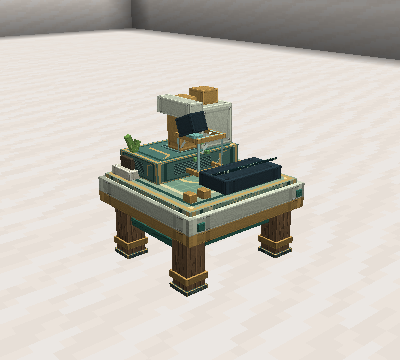
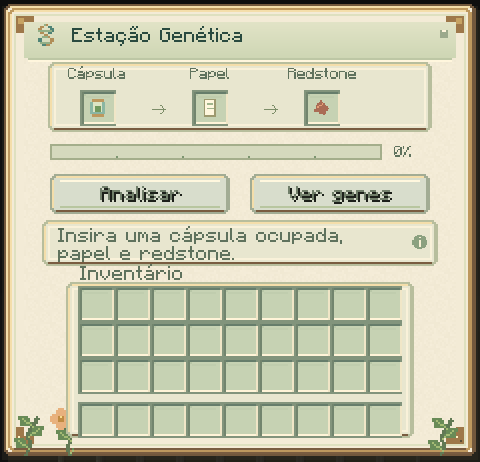

# Estação genética

Analise um indivíduo capturado e consulte seus genes sem liberá-lo no recinto.
O analisador portátil continua disponível para slimes no mundo.



A bancada fica voltada para você na colocação. Seu monitor anima durante a
análise e fica parado quando o trabalho pausa ou termina.

## Receita e uso

Receita de `slimeevolution:genetic_station`:

```text
F V F
R A R
F F F
```

F = lingote de ferro; V = vidro; R = redstone; A = analisador genético.
O bloco também aparece em Ferramentas e Utilidades no criativo. As texturas
de sua carcaça e superfície são originais.

1. Abra a estação e insira uma cápsula ocupada no primeiro espaço.
2. Insira papel e redstone nos dois espaços seguintes.
3. Como cuidador do indivíduo, pressione **Analisar**.
4. Após 100 ticks carregados, pressione **Ver genes** para abrir a inspeção.
5. Retire a cápsula para levá-la ou liberar o indivíduo normalmente.



Uma análise consome **um papel e uma redstone**, somente ao concluir. São
cinco segundos a 20 ticks/s; o processamento usa ticks do servidor e não um
relógio de parede. A barra acompanha o progresso. Remover insumos pausa o
trabalho; recolocá-los retoma o progresso. Remover/trocar o indivíduo cancela
o trabalho sem cobrança. Nenhum trabalho começa apenas por inserir itens.

A análise concluída permanece disponível nessa estação enquanto a mesma
cápsula válida continuar nela. Reabrir a leitura não cobra novamente. Após
remover a cápsula e a estação processar a remoção, uma nova sessão de análise
exige insumos. A pesquisa na Slimepedia continua registrada no jogador.

O resultado abre a inspeção existente com o cabeçalho **Cápsula: …**. Vida,
necessidades, idade, alelos, linhagem e progresso evolutivo são os valores
preservados na captura. O indivíduo não envelhece, se alimenta, se reproduz ou
sofre mutação na estação. Retirar a cápsula, perder acesso ao bloco ou sair do
alcance encerra essa inspeção. A estação realiza leitura e pesquisa genética.

[Pesquisa e progressão](PROGRESSION.md) · [Cuidado e captura](CARE.md)
