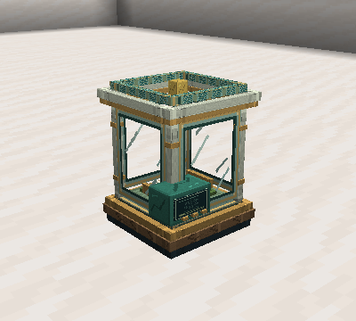
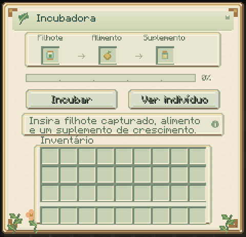

# Incubadora

Promova o crescimento de um filhote capturado, preservando sua identidade,
genes e linhagem. Cada ciclo é iniciado pelo cuidador.



A câmara fica voltada para você na colocação. O console anima enquanto o ciclo
avança e fica parado ao pausar ou concluir. O berço é parte do equipamento;
o indivíduo permanece guardado na cápsula.

## Receita e operação

```text
F V F
V G V
F R F
```

F = ferro; V = vidro; G = geleia reprodutiva; R = redstone.
ID: `slimeevolution:incubator`, também na aba Ferramentas e Utilidades.
Texturas originais da carcaça e superfície acompanham o bloco.

1. Capture um filhote seguindo as regras normais de confiança, vida e energia.
2. Abra a incubadora, insira a cápsula, um alimento da dieta e geleia reprodutiva, catalisador genético ou geleia real.
3. Como cuidador, pressione **Incubar**. O indivíduo precisa ter fome abaixo
   de 80, conforto de pelo menos 40 e energia de pelo menos 20.
4. Após 200 ticks carregados (dez segundos a 20 ticks/s), o ciclo conclui.
5. Use **Ver indivíduo**, retire a cápsula ou inicie outro ciclo se ainda houver
   crescimento pendente e materiais suficientes.



Cada ciclo consome **um alimento compatível e um suplemento**, somente na
conclusão. A geleia reduz o crescimento restante em até **1.200 ticks**; o
catalisador, em até **2.400 ticks**; a Geleia Real, em até **3.600 ticks**,
equivalentes a um/dois/três minutos normais.
Os três suplementos acrescentam **200 ticks de idade cronológica**. Crescimento assistido e idade são contabilizados separadamente.
O tamanho final continua sendo o tamanho adulto determinado anteriormente.

O alimento reduz a fome em até 20 e recupera até dez de energia, com limites
0/100. Conforto e confiança permanecem iguais. A recarga alimentar passa a
100 ticks após concluir. Genoma, linhagem, metamorfose e demais recargas são
preservados; a proporção de vida acompanha a mudança de tamanho. A incubadora
não concede metamorfoses, mutações, reprodução ou confiança.

Sem alimento correto ou suplemento válido, o trabalho pausa. Trocar/remover o espécime
cancela sem cobrar. A conclusão não inicia outro ciclo automaticamente.
Adultos são recusados. O indicador de conclusão permite ler o resultado mesmo
quando o filhote amadureceu; o servidor revalida toda nova solicitação.

## Retirar o indivíduo

Ao concluir, retire a cápsula atualizada. Ela conserva o indivíduo e pode ser
liberada normalmente; cópias anteriores deixam de representar a captura válida.

[Cuidado e captura](CARE.md) · [Suplementos](MATERIALS.md)
