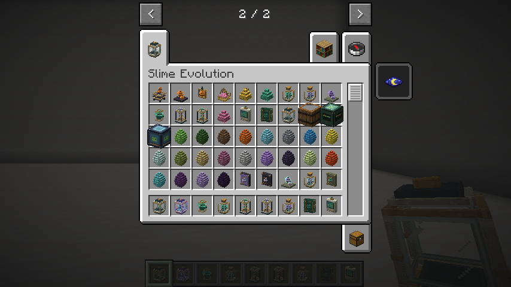

# Materiais e receitas

Use gelatinas, essências e fragmentos para fabricar equipamentos, preparar a
reprodução e auxiliar o crescimento. As receitas ficam no livro do jogo.

Os materiais, instrumentos e recompensas têm modelos SolarPunk com volume,
frascos, gemas, armações e ornamentos próprios.

## Obtenção e receitas

As receitas abaixo são sem formato. Até quatro ingredientes cabem no inventário;
as de cinco ou sete exigem bancada. Ingredientes repetidos ocupam espaços separados.

| Ingredientes | Resultado | Uso |
|---|---|---|
| 1 bola de slime + 1 açúcar | 1 Gelatina Básica | Geleia e catalisadores; base do núcleo |
| 1 gelatina + 2 trigos + 2 bagas brilhantes | 2 geleias reprodutivas | Reprodução e incubação |
| 1 gelatina + 1 ametista + 1 redstone + 1 pó de blaze | 2 Catalisadores Genéticos | Crescimento na incubadora |
| 1 fragmento de ametista + 1 pepita de ferro | 2 Fragmentos Cristalinos | Núcleo e estabilizadores |
| 1 gelatina + 1 Essência Elemental + 2 Fragmentos Cristalinos | 1 Núcleo de Slime | Equipamentos e estabilizadores |
| 1 gelatina + 1 Essência Elemental + 1 redstone | 4 Catalisadores Genéticos | Alternativa baseada em cuidado de elementais |
| 1 núcleo + 1 Fragmento Cristalino + 1 barra de ouro + 1 Essência Elemental | 2 Estabilizadores de Mutação | Proteger o próximo nascimento |
| 1 núcleo + 1 Fragmento Cristalino + 1 Essência Ancestral | 4 Estabilizadores de Mutação | Rota avançada opcional, com maior rendimento |
| 1 núcleo + 1 vidro | 1 cápsula de slime | Alternativa para produzir cápsula |
| 1 núcleo + 3 ferros + 1 vidro + 2 redstones | 1 estação genética | Alternativa que preserva o analisador |

As receitas originais de geleia, cápsula, analisador, estação e incubadora
continuam disponíveis. Assim, começar a análise e reprodução não exige coleta
avançada nem chefe. Essências usadas em receitas devolvem uma garrafa de vidro
por unidade consumida; o restante pode permanecer na grade até fechá-la.
Gelatina é ingrediente, não alimento universal. Fragmento Cristalino é um item
refinado; não é o projétil de Cristal nem substitui automaticamente a ametista
nas metamorfoses existentes.

IDs: `basic_gelatin`, `elemental_essence`, `slime_core`, `crystal_fragment`,
`genetic_catalyst`, `mutation_stabilizer` e `ancestral_essence`, todos em
`slimeevolution`. Nenhum material novo é drop obrigatório da morte de um slime.

## Coletar essências

Use uma **garrafa de vidro** no adulto vivo e cuidado. A família
`slimeevolution:elemental` fornece Essência Elemental: Fogo, Gelo, Água,
Elétrico, Vento e Venenoso. A espécie Ancestral fornece Essência Ancestral.
Outras espécies não fornecem essência por garrafa. Espécies de datapacks que
usam a família elemental participam da mesma regra.

A coleta exige o cuidador, permissão de construção/interação, alcance e visão
livre. O adulto precisa ter confiança de pelo menos 60, fome até 40, conforto
e energia de pelo menos 60 e vida de pelo menos 75%. Não pode estar em combate,
prontidão reprodutiva, reação recente à captura, montado, transportando entidade
ou preso por laço. Uma recusa não cobra garrafa ou necessidades nem pesquisa.

Cada coleta entrega **uma essência**, reduz energia em 20, aumenta fome em dez
e inicia recuperação de **6.000 ticks carregados**, cinco minutos a 20 ticks/s.
Não causa dano, muda genes/linhagem ou concede confiança. A garrafa é trocada
pelo resultado; com várias garrafas, o resultado vai ao inventário ou cai perto
do jogador se estiver cheio. No criativo, segue o comportamento vanilla de
recipientes: mantém a garrafa e adiciona a essência se necessário.

A recuperação persiste em save/load e captura/liberação. Na cápsula fica
congelada, como as demais recargas individuais; tempo offline não a elimina.
O analisador mostra a recuperação ao passar o cursor na linha de reprodução.
Slimepedia registra o produto na aba Campo **somente para quem coletou**.
Observar, analisar ou tentar uma coleta recusada não revela esse fato.

Ancestral continua sendo obtido pela metamorfose avançada de Vazio existente,
com suas condições e estrela do Nether. Essa rota fornece rendimento maior,
mas a receita elemental produz o mesmo estabilizador sem exigir Ancestral.

## Estabilizar o próximo nascimento

Use um Estabilizador de Mutação em um dos pais **antes da geleia**. Exige o
cuidador ao alcance, permissão/visão e um adulto apto à reprodução pelas regras
normais. Consome uma unidade, exceto no criativo. Aplicações repetidas são
recusadas sem cobrar; o analisador mostra **Estab. Sim** e o tooltip explica
que se refere ao próximo nascimento.

Se qualquer pai estiver estabilizado, o próximo nascimento do par tem chance
zero de **novas mutações numéricas**. Os alelos continuam sendo escolhidos dos
pais; a proteção não apaga alelos herdados, modifica genomas existentes ou
concede espécie híbrida sem receita. O filhote recebe histórico conhecido sem
nova alteração e não herda a proteção. Se ambos os pais foram tratados, ambos
consomem seus efeitos nesse nascimento.

A proteção só é removida quando o filhote é inserido com sucesso no mundo,
junto dos custos parentais. Falta de espaço, cancelamento, par incompatível ou
expiração da prontidão não a consomem. Persiste em save/load, cápsula e mudanças
de espécie. A reprodução seguinte volta à chance configurada normal quando
não houver outra aplicação. Não há repetição automática nem edição no cliente.

## Suplementos da incubadora

O terceiro espaço aceita geleia ou catalisador. O suplemento presente **na
conclusão** determina o avanço e é o item consumido:

| Custo por ciclo, além de um alimento da espécie | Crescimento máximo | Duração carregada |
|---|---|---|
| 1 geleia reprodutiva | 1.200 ticks, um minuto normal | 200 ticks, dez segundos |
| 1 Catalisador Genético | 2.400 ticks, dois minutos normais | 200 ticks, dez segundos |
| 1 Geleia Real (recompensa do Rei) | 3.600 ticks, três minutos normais | 200 ticks, dez segundos |

Os suplementos acrescentam apenas 200 ticks de idade e a mesma nutrição limitada,
preservando genoma, mutações, pais, espécie e tamanho adulto. O catalisador
não altera a chance de mutação. Pausa, custos, tokens e integridade estão em
[INCUBATOR.md](INCUBATOR.md).

## Livro de receitas e descobertas

| Obter | Receitas desbloqueadas |
|---|---|
| Bola de slime | Gelatina Básica |
| Gelatina Básica | Geleia em lote e catalisador inicial |
| Fragmento de ametista | Fragmento Cristalino |
| Essência Elemental | Núcleo e catalisador com essência |
| Núcleo | Estabilizador elemental, cápsula e estação alternativas |
| Essência Ancestral | Estabilizador ancestral |

Desbloqueio de receitas e pesquisa pessoal da Slimepedia são independentes.
Os registros pessoais de coleta são salvos no diário schema 3; schemas 1 e 2
mantêm seus fatos e não ganham coletas retroativas.

## Materiais dos bosses

Geleia Real, Fragmento Ígneo, Estilhaço Prismático e Essência Primordial vêm
dos quatro encontros. Consulte [bosses e recompensas](BOSSES.md).

O Selo Primordial usa Geleia Real, Fragmento Ígneo, Estilhaço Prismático,
Estrela do Nether e Tabuleta Antiga. Serve tanto ao ritual do boss na Câmara
quanto à metamorfose de Vazio em Ancestral; cada uso aceito consome um Selo.
Veja [as conquistas](ASCENSION.md).
