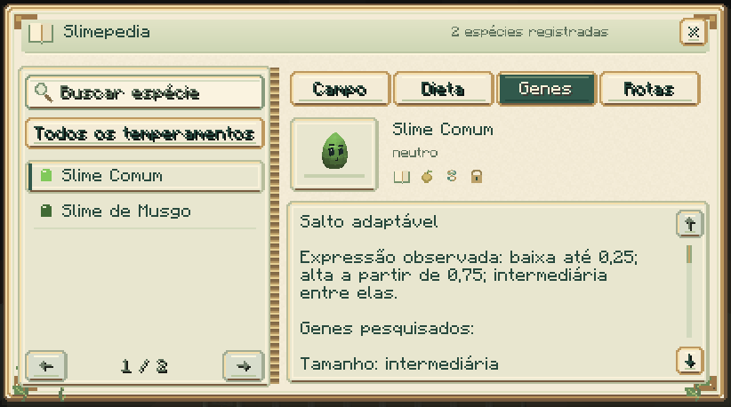
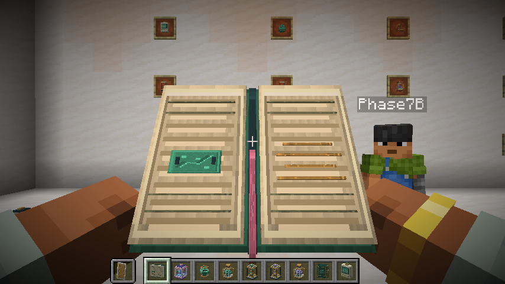
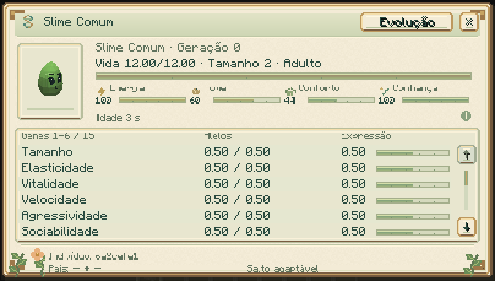

# Pesquisa e progressão

[Guia do mod](../README.md) · [Materiais](MATERIALS.md) · [Evolução](EVOLUTION.md)

## Slimepedia

Combine **um livro e uma bola de slime** para criar a Slimepedia. Use-a em um
slime vivo e próximo para registrar a espécie; use-a no ar para consultar seu
diário. Um clique ergue e abre o livro com as duas mãos antes de mostrar a
consulta; funciona também segurando a Slimepedia na mão secundária. Feche com
Esc ou o botão ×. A opção de movimento reduzido pula a transição de abertura.
Busca, filtros e quatro abas organizam as descobertas. A página mostra uma
prévia 3D da espécie observada; as abas e os ícones indicam o avanço da pesquisa.

| Aba | O que revela | Como avançar |
|---|---|---|
| Campo | Espécie, temperamento e locais observados | Observar com o livro |
| Dieta | Alimentos compatíveis | Alimentar manualmente com sucesso |
| Genes | Habilidade e pesquisa genética | Analisar um indivíduo ou sua cápsula |
| Rotas | Cruzamentos e metamorfoses realizados | Presenciar o nascimento como cuidador ou concluir a transformação |

O diário é pessoal e compartilhado entre seus livros. Observar, alimentar e
analisar são descobertas independentes. O catálogo ainda não observado fica
oculto; trocar livros não transfere pesquisa.

## Analisador e estação genética

Use o **analisador genético** em um slime para consultar suas necessidades,
idade, parentesco, alelos e rotas de evolução. Vida e necessidades aparecem em
barras; a tabela compara os alelos e a expressão. Passe o mouse sobre os genes,
as informações de tempo e o rodapé para consultar os detalhes.

A [estação genética](GENETIC_STATION.md) analisa um indivíduo dentro da cápsula.
Insira cápsula ocupada, papel e redstone, pressione **Analisar** e depois
**Ver genes**. A análise leva 100 ticks carregados e cobra os materiais ao concluir.

## Vínculo e equipes

Agache e use o analisador em seu próprio slime para abrir o painel de
[vínculo e treinamento](COMPANIONS.md). Ensine Esperar, Seguir e Voltar ao lar,
marque um local seguro e ative a cooperação dos parceiros. Água + Musgo ajudam
plantas; Elétrico + Ferro apoiam a estação e a incubadora.

## Incubadora

A [incubadora](INCUBATOR.md) acelera o crescimento de um filhote capturado.
Cada ciclo manual exige alimento da dieta e um suplemento, e leva 200 ticks
carregados. O filhote conserva seus genes e sua linhagem.

## Herança e pesquisa

Reproduza adultos [compatíveis e bem cuidados](BREEDING.md). O filhote herda
alelos dos pais e pode apresentar mutações. A pesquisa diferencia alterações
registradas no nascimento de herança comum e de histórico indisponível.
[Como interpretar a pesquisa](GENETIC_RESEARCH.md).

## Rotas avançadas

Colete [materiais e essências](MATERIALS.md), descubra cruzamentos e prepare as
condições das [metamorfoses](EVOLUTION.md). Os [bosses](BOSSES.md) entregam
materiais usados em equipamentos, incubação e formas raras, como Prismático
e Celestial.

## Guia online

Na parte superior da Slimepedia, **Guia online** abre a documentação completa no navegador. Confira o endereço na confirmação; ao cancelar ou retornar, você continua no livro.

[Consultar o guia](https://eduardinds02.github.io/Slime-Evolution-Mod-Docs/).
