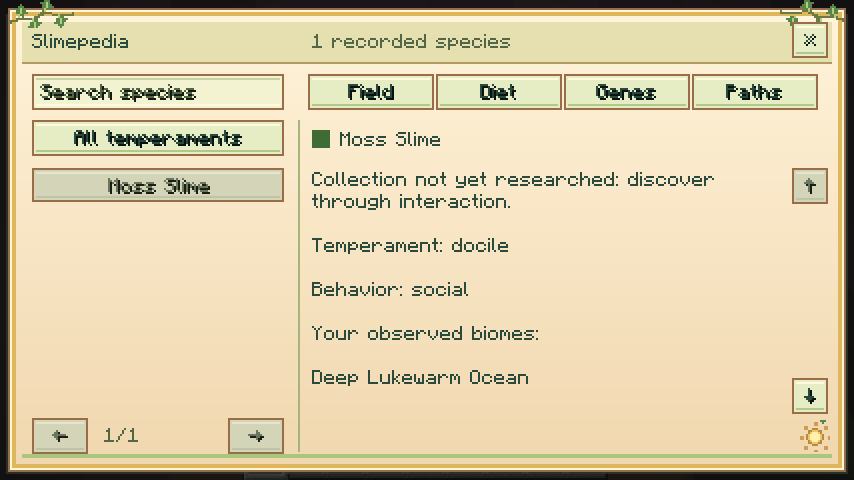
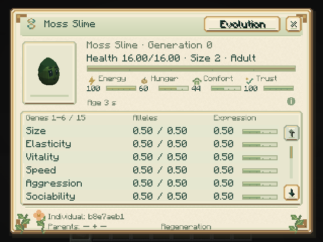

# Research and Progression

## Slimepedia

Craft a Slimepedia from **one book and one slimeball**. Version 0.15.0 also gives each player a book on their first login to a world, once per player. Use it on a live nearby slime to record a species; use it in the air to browse your journal.

The book opens in both hands before showing the interface and also works from the offhand. Escape or the close button ends reading. Reduced motion skips the opening transition. Search, filters, four tabs, and a 3D species preview organize discoveries.

| Tab | Knowledge | How to unlock it |
|---|---|---|
| Field | Species, temperament, observed habitats | Observe with the book |
| Diet | Compatible foods | Successfully feed manually |
| Genes | Ability and genetic research | Analyze an individual or capsule |
| Paths | Completed crosses and metamorphoses | Witness a birth as caretaker or complete a transformation |

The journal belongs to the player and is shared by all their books. Observation, feeding, and analysis are independent discoveries. Unobserved catalog entries remain hidden; trading books does not transfer research.

## Analyzer and Genetic Station

Use the **Genetic Analyzer** on a slime to inspect needs, age, ancestry, alleles, and evolution routes. Hover over genes, time information, and the footer for details.

The [Genetic Station](GENETIC_STATION.md) analyzes an occupied capsule. Insert capsule, paper, and redstone, press Analyze, then View genes. A cycle takes 100 loaded ticks and charges on completion.

## Bond and teams

Crouch and use the analyzer on your slime to open [training](COMPANIONS.md). Teach Wait, Follow, and Return home, mark a safe home, and enable cooperation. Water + Moss help crops; Electric + Iron assist machines.

## Incubation and inheritance

The [Incubator](INCUBATOR.md) accelerates captured juvenile growth. Each manual cycle needs compatible food and a supplement and takes 200 loaded ticks. Genes and lineage remain intact.

[Breed compatible, well-cared-for adults](BREEDING.md). Offspring inherit parental alleles and may mutate. [Genetic research](GENETIC_RESEARCH.md) distinguishes recorded birth mutations from ordinary inheritance and unavailable history.

## Advanced routes

Gather [materials](MATERIALS.md), discover [crosses and metamorphoses](EVOLUTION.md), and challenge [bosses](BOSSES.md) for materials used in equipment, incubation, and rare lineages such as Prismatic and Celestial.

## Online guide and advancements

The **Online guide** button opens the full guide in a browser. Review the address in Minecraft's confirmation dialog; canceling or returning preserves your book view.

Version 0.15.0 includes 16 Minecraft advancements for obtaining the book and equipment, research, breeding, metamorphosis, species collections, and boss victories. Open Advancements with **L** by default.
