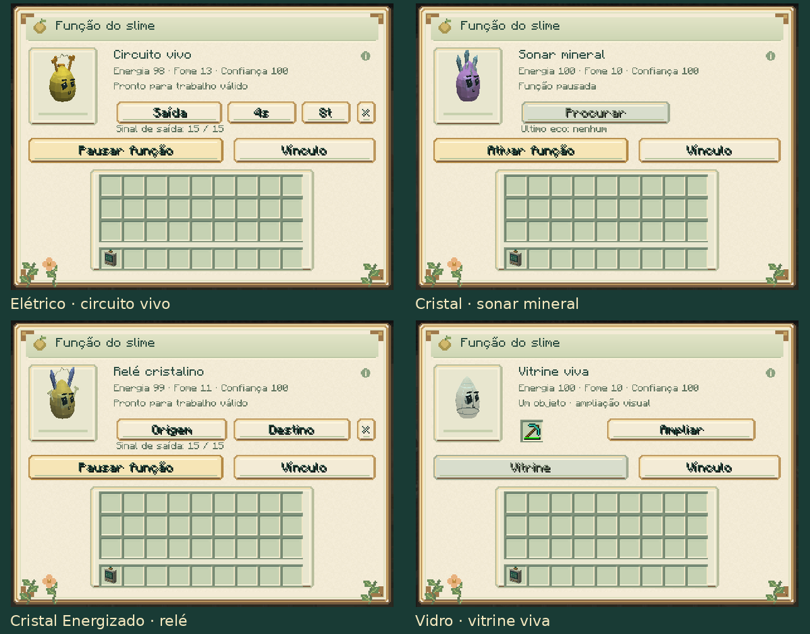
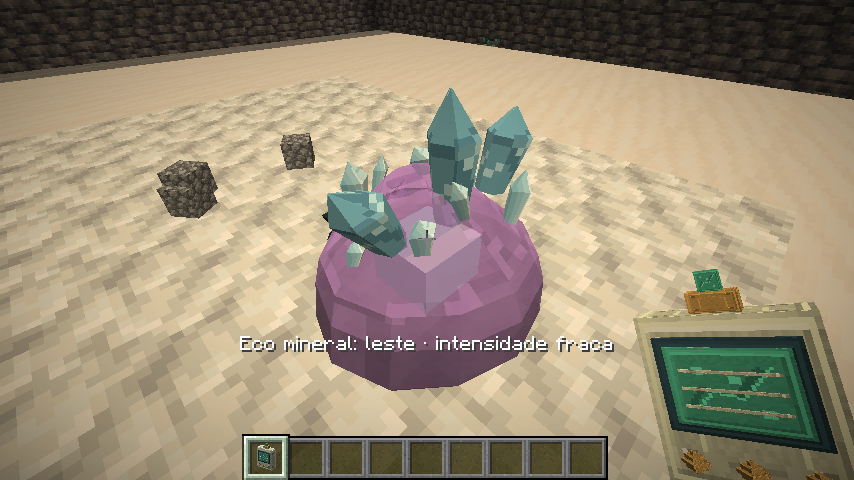
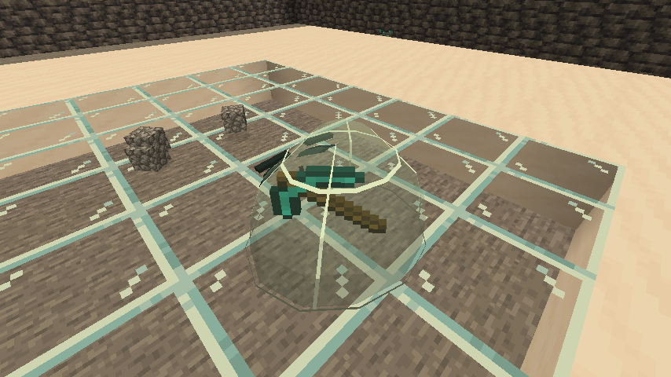

# Circuitos, sonar e vitrine

[Guia do mod](../README.md) · [Funções individuais](SPECIALIZATIONS.md) · [Treino](COMPANIONS.md)

Elétrico, Cristal, Cristal Energizado e Vidro têm funções próprias no painel
**Função**, acessado ao agachar e usar o analisador no seu slime.

| Slime | Função | Treino necessário | Custo |
|---|---|---:|---|
| Elétrico | Circuito vivo | 20 pontos | 2 de energia e +1 de fome por pulso aceito |
| Cristal | Sonar mineral | 20 pontos | 4 de energia e +2 de fome ao encontrar um eco |
| Cristal Energizado | Relé cristalino | 40 pontos | 1 de energia ao iniciar e a cada segundo de sinal ativo |
| Vidro | Vitrine viva | 0 | Exposição e ampliação sem custo de energia |

Os três trabalhos ativos exigem adulto calmo, confiança 40, energia mínima 30,
fome até 60 e conforto 40. Começam pausados. O cuidador precisa ter permissão
de construção e permanecer conectado na mesma dimensão para os circuitos.

## Elétrico: pulsos ajustáveis

1. No painel, pressione **Saída**.
2. Use o analisador no piso escolhido, deixando livre o espaço acima.
3. Mantenha o slime a até seis blocos da saída, com visão livre.
4. Ajuste os dois botões ao lado e pressione **Ativar função**.

O intervalo alterna entre **1, 2, 4 e 8 segundos**. A duração alterna entre
**2, 4, 8 e 10 ticks**: de 0,1 a 0,5 segundo, a 20 ticks por segundo.
O padrão é intervalo de dois segundos e duração de quatro ticks.
Cada ajuste pausa o trabalho para permitir concluir a configuração.

A saída emite intensidade **15** e pode alimentar redstone, um dropper,
pistões e outros mecanismos próximos. O pequeno ponto de saída aparece durante
o pulso. Se o espaço estiver ocupado, o slime aguarda sem substituir o bloco
ou cobrar pelo pulso recusado. O botão **×** limpa o vínculo e pausa a função.

## Cristal: encontrar concentrações minerais

Ative a função e pressione **Procurar**. O painel fecha para mostrar a pulsação
e a mensagem com **direção e intensidade**: fraca, média ou forte.
O levantamento alcança até **12 blocos**, inclusive através de pedra, e procura
concentrações de pelo menos quatro blocos minerais no mesmo setor direcional.

São reconhecidos minérios e blocos de ametista. Um veio isolado pode não gerar
um eco significativo; a indicação ajuda a escolher uma direção de exploração.
O trabalho preserva os blocos encontrados e respeita as regiões protegidas.
Opera somente nos chunks já carregados.

Cada levantamento tem **dez segundos de recuperação**. Um levantamento sem
eco mantém essa recuperação e conserva energia e alimentação. O painel mostra
a intensidade do último eco; essa indicação é temporária, enquanto a recuperação
é preservada no save e na cápsula.

## Cristal Energizado: transmitir um sinal

1. Pressione **Origem** e use o analisador no bloco de entrada, como uma
   alavanca, placa de pressão ou trecho de redstone.
2. Pressione **Destino** e escolha o piso de uma saída livre.
3. Deixe o slime a até seis blocos da saída e ative a função.

Entrada e saída precisam estar na mesma dimensão, separadas por **4 a 32 blocos**,
e ambas devem estar carregadas. O relé preserva a intensidade analógica de
**0 a 15**. Desligar a entrada desliga a saída; entrada sem sinal não cobra energia.
É possível conectar circuitos que usam comparadores e sensores de intensidade.

A saída se apaga automaticamente ao pausar, capturar ou remover o slime,
ou quando o cuidador fica indisponível. Os pontos de saída são temporários;
um sinal salvo sem a sua fonte válida não alimenta mecanismos ao recarregar.
Os circuitos respeitam `mobGriefing`, permissões e a proteção das arenas.

## Vidro: expor um objeto real

Coloque **um objeto** no compartimento da vitrine. Ele aparece girando dentro
do corpo transparente do slime. **Ampliar** aumenta a exibição, e **Tamanho normal**
restaura a escala. O núcleo fica oculto enquanto o objeto ocupa a vitrine.

A vitrine é passiva: basta confiança 40 para guardar o objeto pelo painel.
A ampliação é visual e conserva quantidade, durabilidade, nome e encantamentos.
O mesmo objeto pode ser retirado normalmente. Cápsulas e recipientes com
inventários internos são recusados.

Capturar e soltar conserva o objeto e o tamanho escolhido. Ao morrer, o slime
solta seus pertences. Cargas antigas continuam disponíveis para retirada,
mesmo que tenham sido guardadas antes de o indivíduo adquirir essa função.

[Outros trabalhos](WORK_JOBS.md) · [Captura e cuidado](CARE.md)
