# Galeria de slimes

[Guia do mod](../README.md) · [Cuidado e captura](CARE.md) · [Reprodução](BREEDING.md) · [Evolução](EVOLUTION.md)

As **47 espécies** da versão 0.14.2, com capturas reais do jogo. Cor e tamanho podem variar conforme a genética; as imagens foram apenas recortadas e redimensionadas para enquadrar cada slime.

São **21 espécies naturais** e **26 formas obtidas por reprodução ou metamorfose**. As dietas abaixo vêm das definições padrão do mod e podem mudar com datapacks. Para chefes e lacaios, consulte a [galeria de bosses](BOSSES.md).

## Espécies naturais

<table>
<tr>
<td valign="top" width="50%">
<h3>Slime de Ametista</h3>
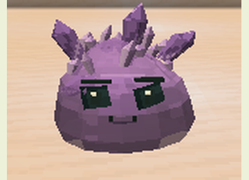

Ressonância destaca ameaças; blocos de ametista prolongam o efeito.

<strong>Temperamento:</strong> Neutro <strong>Alimentos:</strong> fragmento de ametista, bagas brilhantes <strong>Obtenção:</strong> Encontro natural.

<code>slimeevolution:amethyst</code>

</td>
<td valign="top" width="50%">
<h3>Slime Comum</h3>
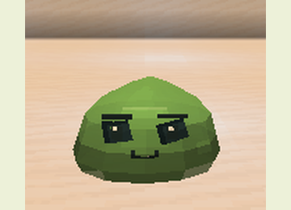

Adaptável, com saltos especialmente elásticos.

<strong>Temperamento:</strong> Neutro <strong>Alimentos:</strong> bola de slime, maçã, trigo <strong>Obtenção:</strong> Encontro natural.

<code>slimeevolution:common</code>

</td>
</tr>
<tr>
<td valign="top" width="50%">
<h3>Slime Corrompido</h3>
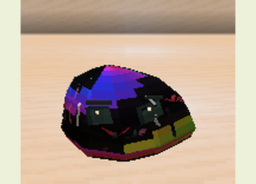

Agressivo; deteriora alvos e aumenta a chance de mutação nos descendentes.

<strong>Temperamento:</strong> Hostil <strong>Alimentos:</strong> carne podre, olho de aranha <strong>Obtenção:</strong> Encontro natural.

<code>slimeevolution:corrupted</code>

</td>
<td valign="top" width="50%">
<h3>Slime Elétrico</h3>
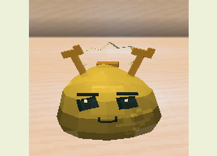

Defende seu território; descargas se propagam entre alvos molhados.

<strong>Temperamento:</strong> Neutro <strong>Alimentos:</strong> redstone, pó de pedra luminosa <strong>Obtenção:</strong> Encontro natural.

<code>slimeevolution:electric</code>

</td>
</tr>
<tr>
<td valign="top" width="50%">
<h3>Slime do End</h3>
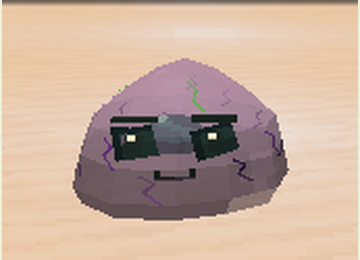

Recua por teletransporte curto e seguro quando ferido e ameaçado.

<strong>Temperamento:</strong> Neutro <strong>Alimentos:</strong> fruta do coro, pérola do End <strong>Obtenção:</strong> Encontro natural.

<code>slimeevolution:end</code>

</td>
<td valign="top" width="50%">
<h3>Slime de Fogo</h3>
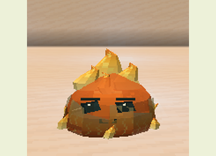

Imune ao fogo; incendeia inimigos, mas sofre dano na água.

<strong>Temperamento:</strong> Hostil <strong>Alimentos:</strong> carvão mineral, pó de blaze <strong>Obtenção:</strong> Encontro natural.

<code>slimeevolution:fire</code>

</td>
</tr>
<tr>
<td valign="top" width="50%">
<h3>Slime Fúngico</h3>
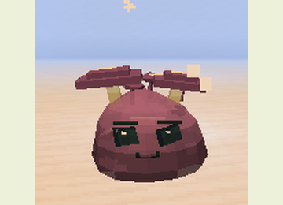

Esporos enfraquecem ameaças; cogumelos próximos ajudam na recuperação.

<strong>Temperamento:</strong> Dócil <strong>Alimentos:</strong> cogumelo marrom, cogumelo vermelho <strong>Obtenção:</strong> Encontro natural.

<code>slimeevolution:fungal</code>

</td>
<td valign="top" width="50%">
<h3>Slime de Gelo</h3>
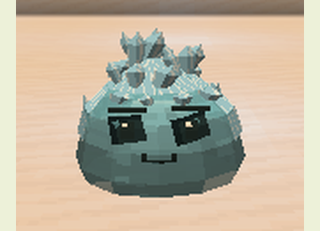

Resfria inimigos, resiste ao congelamento e é vulnerável ao fogo.

<strong>Temperamento:</strong> Hostil <strong>Alimentos:</strong> bola de neve, gelo <strong>Obtenção:</strong> Encontro natural.

<code>slimeevolution:ice</code>

</td>
</tr>
<tr>
<td valign="top" width="50%">
<h3>Slime de Ferro</h3>
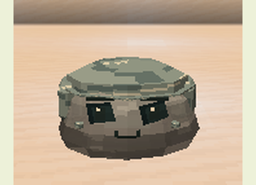

Corpo pesado que resiste a golpes corpo a corpo e empurrões.

<strong>Temperamento:</strong> Neutro <strong>Alimentos:</strong> pepita de ferro, ferro bruto <strong>Obtenção:</strong> Encontro natural.

<code>slimeevolution:iron</code>

</td>
<td valign="top" width="50%">
<h3>Slime Luminoso</h3>
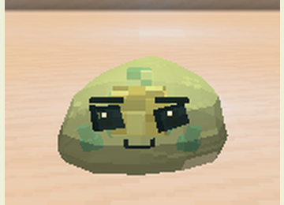

Corpo emissivo; ajuda o cuidador a enxergar em cavernas escuras.

<strong>Temperamento:</strong> Dócil <strong>Alimentos:</strong> bagas brilhantes, bolsa de tinta brilhante <strong>Obtenção:</strong> Encontro natural.

<code>slimeevolution:luminous</code>

</td>
</tr>
<tr>
<td valign="top" width="50%">
<h3>Slime de Magma</h3>
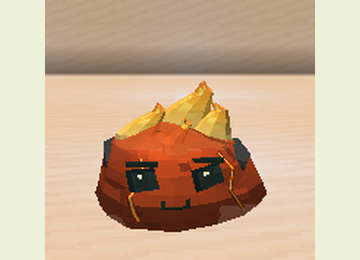

Recupera-se na lava e incendeia inimigos quando aquecido.

<strong>Temperamento:</strong> Hostil <strong>Alimentos:</strong> creme de magma, pó de blaze <strong>Obtenção:</strong> Encontro natural.

<code>slimeevolution:magma</code>

</td>
<td valign="top" width="50%">
<h3>Slime de Musgo</h3>
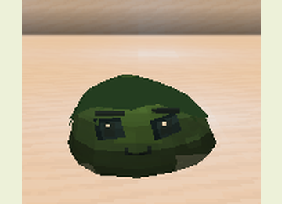

Regenera quando molhado ou sobre musgo.

<strong>Temperamento:</strong> Dócil <strong>Alimentos:</strong> bloco de musgo, bagas brilhantes <strong>Obtenção:</strong> Encontro natural.

<code>slimeevolution:moss</code>

</td>
</tr>
<tr>
<td valign="top" width="50%">
<h3>Slime de Lama</h3>
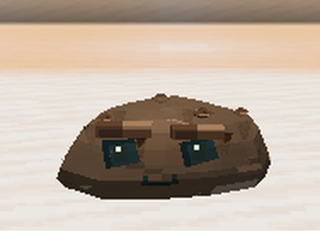

Defende-se desacelerando seus agressores.

<strong>Temperamento:</strong> Neutro <strong>Alimentos:</strong> lama, bola de argila <strong>Obtenção:</strong> Encontro natural.

<code>slimeevolution:mud</code>

</td>
<td valign="top" width="50%">
<h3>Slime de Obsidiana</h3>
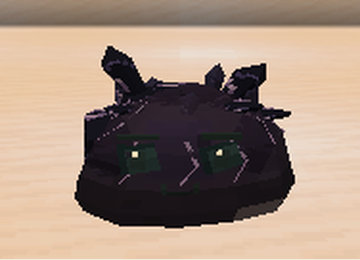

Corpo lento e pesado, protegido contra explosões.

<strong>Temperamento:</strong> Neutro <strong>Alimentos:</strong> obsidiana, obsidiana chorona <strong>Obtenção:</strong> Encontro natural.

<code>slimeevolution:obsidian</code>

</td>
</tr>
<tr>
<td valign="top" width="50%">
<h3>Slime de Areia</h3>
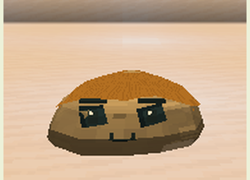

Camufla-se parado sobre areia e lança poeira que cega.

<strong>Temperamento:</strong> Neutro <strong>Alimentos:</strong> areia, cacto <strong>Obtenção:</strong> Encontro natural.

<code>slimeevolution:sand</code>

</td>
<td valign="top" width="50%">
<h3>Slime de Almas</h3>
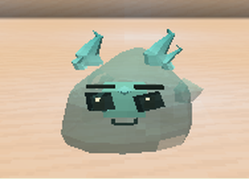

Move-se na areia das almas; drena vitalidade sobre terreno de almas.

<strong>Temperamento:</strong> Neutro <strong>Alimentos:</strong> areia das almas, terra das almas <strong>Obtenção:</strong> Encontro natural.

<code>slimeevolution:souls</code>

</td>
</tr>
<tr>
<td valign="top" width="50%">
<h3>Slime de Pedra</h3>
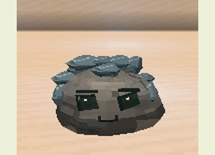

Armadura elevada e resistência a empurrões, com movimentos lentos.

<strong>Temperamento:</strong> Neutro <strong>Alimentos:</strong> pedregulho, sílex <strong>Obtenção:</strong> Encontro natural.

<code>slimeevolution:stone</code>

</td>
<td valign="top" width="50%">
<h3>Slime Venenoso</h3>
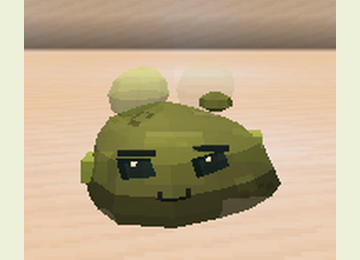

Defende seu território deixando uma nuvem tóxica temporária.

<strong>Temperamento:</strong> Neutro <strong>Alimentos:</strong> olho de aranha, cogumelo marrom <strong>Obtenção:</strong> Encontro natural.

<code>slimeevolution:venom</code>

</td>
</tr>
<tr>
<td valign="top" width="50%">
<h3>Slime do Vazio</h3>
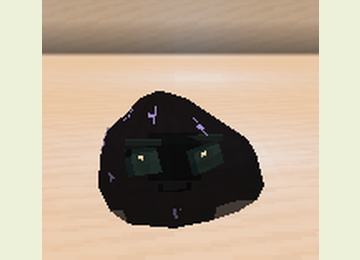

Atrai uma ameaça próxima e visível com um breve impulso espacial.

<strong>Temperamento:</strong> Neutro <strong>Alimentos:</strong> fruta do coro estourada, pérola do End <strong>Obtenção:</strong> Encontro natural.

<code>slimeevolution:void</code>

</td>
<td valign="top" width="50%">
<h3>Slime de Água</h3>
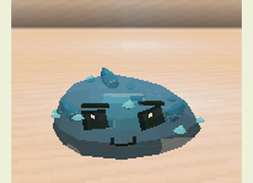

Nada com facilidade, respira na água e empurra inimigos com jatos.

<strong>Temperamento:</strong> Dócil <strong>Alimentos:</strong> alga, erva marinha <strong>Obtenção:</strong> Encontro natural.

<code>slimeevolution:water</code>

</td>
</tr>
<tr>
<td valign="top" width="50%">
<h3>Slime de Vento</h3>
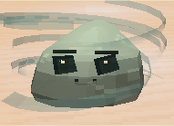

Salta mais alto, amortece quedas e afasta inimigos com rajadas.

<strong>Temperamento:</strong> Neutro <strong>Alimentos:</strong> pena, açúcar <strong>Obtenção:</strong> Encontro natural.

<code>slimeevolution:wind</code>

</td>
<td></td>
</tr>
</table>

## Híbridos e metamorfoses

<table>
<tr>
<td valign="top" width="50%">
<h3>Slime Abissal</h3>
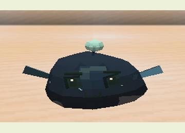

Uma isca luminosa guia seu corpo escuro e suas nadadeiras profundas.

<strong>Temperamento:</strong> Neutro <strong>Alimentos:</strong> bolsa de tinta brilhante, alga <strong>Obtenção:</strong> Metamorfose de Aquático Glacial.

<code>slimeevolution:abyssal</code>

</td>
<td valign="top" width="50%">
<h3>Slime de Âmbar</h3>
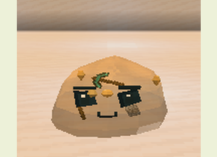

Resina dourada envolve gravetos, pedregulho e uma picareta decorativa; seu contato é pegajoso.

<strong>Temperamento:</strong> Dócil <strong>Alimentos:</strong> favo de mel, trigo <strong>Obtenção:</strong> Metamorfose de Musgo.

<code>slimeevolution:amber</code>

</td>
</tr>
<tr>
<td valign="top" width="50%">
<h3>Slime Ancestral</h3>
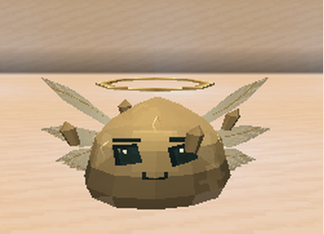

Metamorfose avançada que protege temporariamente o cuidador ferido.

<strong>Temperamento:</strong> Dócil <strong>Alimentos:</strong> cenoura dourada, melancia reluzente <strong>Obtenção:</strong> Metamorfose de Vazio.

<code>slimeevolution:ancestral</code>

</td>
<td valign="top" width="50%">
<h3>Slime de Aurora</h3>
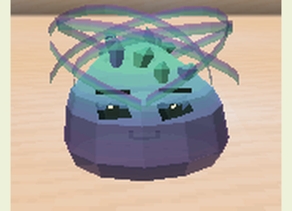

Um gradiente de cores e uma aurora animada protegem aliados próximos.

<strong>Temperamento:</strong> Dócil <strong>Alimentos:</strong> fragmento de ametista, pó de pedra luminosa <strong>Obtenção:</strong> Metamorfose de Prismático.

<code>slimeevolution:aurora</code>

</td>
</tr>
<tr>
<td valign="top" width="50%">
<h3>Slime Pantanoso</h3>
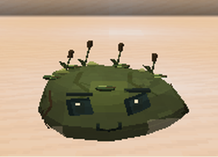

Híbrido dócil de musgo e lama que desacelera agressores.

<strong>Temperamento:</strong> Dócil <strong>Alimentos:</strong> bola de argila, bagas brilhantes <strong>Obtenção:</strong> Musgo + Lama; Musgo + Água.

<code>slimeevolution:bog</code>

</td>
<td valign="top" width="50%">
<h3>Slime Cáustico</h3>
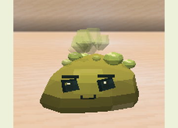

Suas bolhas deixam poças ácidas temporárias que enfraquecem inimigos.

<strong>Temperamento:</strong> Hostil <strong>Alimentos:</strong> olho de aranha, creme de magma <strong>Obtenção:</strong> Venenoso + Magma.

<code>slimeevolution:caustic</code>

</td>
</tr>
<tr>
<td valign="top" width="50%">
<h3>Slime Celestial</h3>
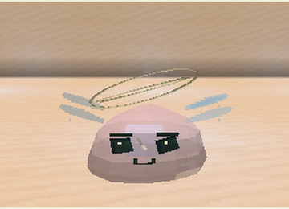

Metamorfose rara de Ancestral com essência Primordial e alta estabilidade.

<strong>Temperamento:</strong> Dócil <strong>Alimentos:</strong> cenoura dourada, melancia reluzente <strong>Obtenção:</strong> Metamorfose de Ancestral.

<code>slimeevolution:celestial</code>

</td>
<td valign="top" width="50%">
<h3>Slime de Coral</h3>
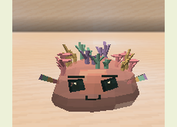

Um aglomerado de corais ramificados favorece a recuperação de aliados na água.

<strong>Temperamento:</strong> Dócil <strong>Alimentos:</strong> erva marinha, alga <strong>Obtenção:</strong> Água + Floral.

<code>slimeevolution:coral</code>

</td>
</tr>
<tr>
<td valign="top" width="50%">
<h3>Slime de Cristal</h3>
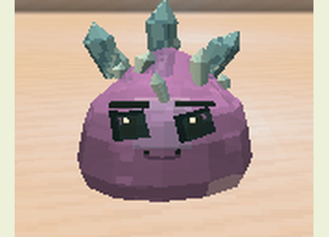

Dispara fragmentos cristalinos e mantém proteção mineral.

<strong>Temperamento:</strong> Neutro <strong>Alimentos:</strong> fragmento de ametista, quartzo <strong>Obtenção:</strong> Metamorfose de Pedra.

<code>slimeevolution:crystal</code>

</td>
<td valign="top" width="50%">
<h3>Slime de Eclipse</h3>
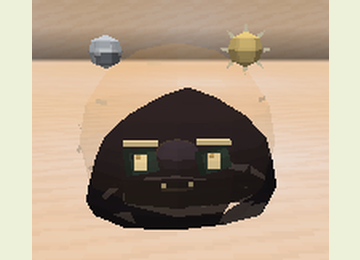

Uma silhueta escura cercada por uma corona dourada alterna ataques solares e lunares.

<strong>Temperamento:</strong> Neutro <strong>Alimentos:</strong> pó de blaze, fragmento de ametista <strong>Obtenção:</strong> Solar + Lunar.

<code>slimeevolution:eclipse</code>

</td>
</tr>
<tr>
<td valign="top" width="50%">
<h3>Slime de Cristal Energizado</h3>
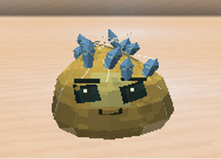

Cristal e Elétrico dividem uma recarga para estilhaços e descarga.

<strong>Temperamento:</strong> Neutro <strong>Alimentos:</strong> fragmento de ametista, redstone <strong>Obtenção:</strong> Cristal + Elétrico.

<code>slimeevolution:energized_crystal</code>

</td>
<td valign="top" width="50%">
<h3>Slime de Ferrofluido</h3>
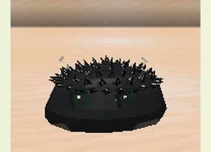

Espículas metálicas móveis atraem metais deixados pelo seu cuidador.

<strong>Temperamento:</strong> Neutro <strong>Alimentos:</strong> pepita de ferro, ferro bruto <strong>Obtenção:</strong> Ferro + Água.

<code>slimeevolution:ferrofluid</code>

</td>
</tr>
<tr>
<td valign="top" width="50%">
<h3>Slime Floral</h3>
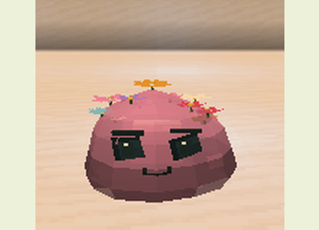

Forma de musgo florescida, com recuperação mais frequente.

<strong>Temperamento:</strong> Dócil <strong>Alimentos:</strong> bagas brilhantes, dente-de-leão <strong>Obtenção:</strong> Metamorfose de Musgo.

<code>slimeevolution:floral</code>

</td>
<td valign="top" width="50%">
<h3>Slime Aquático Glacial</h3>
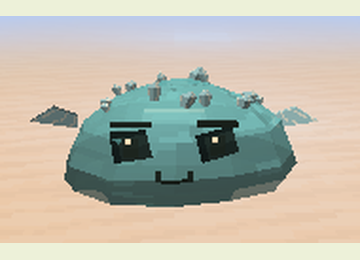

Água e Gelo combinam jato gélido com movimento aquático.

<strong>Temperamento:</strong> Neutro <strong>Alimentos:</strong> alga, bola de neve <strong>Obtenção:</strong> Água + Gelo.

<code>slimeevolution:glacial_aquatic</code>

</td>
</tr>
<tr>
<td valign="top" width="50%">
<h3>Slime de Vidro</h3>
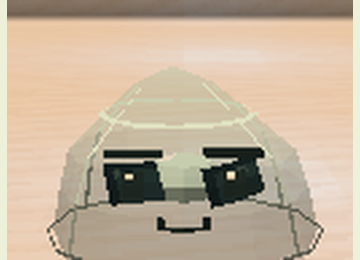

Gel transparente com bordas vitrificadas que refratam luz e projéteis.

<strong>Temperamento:</strong> Neutro <strong>Alimentos:</strong> areia, quartzo <strong>Obtenção:</strong> Areia + Fogo.

<code>slimeevolution:glass</code>

</td>
<td valign="top" width="50%">
<h3>Slime Colmeia</h3>
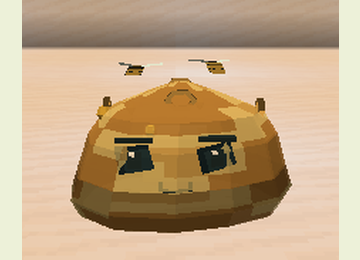

Favos com mel escorrendo abrigam abelhas e pequenos polinizadores temporários.

<strong>Temperamento:</strong> Dócil <strong>Alimentos:</strong> favo de mel, dente-de-leão <strong>Obtenção:</strong> Metamorfose de Âmbar.

<code>slimeevolution:hive</code>

</td>
</tr>
<tr>
<td valign="top" width="50%">
<h3>Slime Lunar</h3>
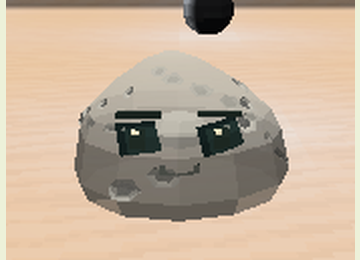

Gel prateado com crateras e lua cheia; sua luz ajuda aliados durante a noite.

<strong>Temperamento:</strong> Dócil <strong>Alimentos:</strong> fragmento de ametista, bagas brilhantes <strong>Obtenção:</strong> Metamorfose de Luminoso.

<code>slimeevolution:lunar</code>

</td>
<td valign="top" width="50%">
<h3>Slime Magmático</h3>
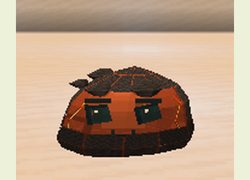

Calor herdado do fogo, corpo reforçado por minerais.

<strong>Temperamento:</strong> Neutro <strong>Alimentos:</strong> creme de magma, pó de blaze <strong>Obtenção:</strong> Pedra + Fogo; Metamorfose de Fogo.

<code>slimeevolution:magmatic</code>

</td>
</tr>
<tr>
<td valign="top" width="50%">
<h3>Slime de Micélio</h3>
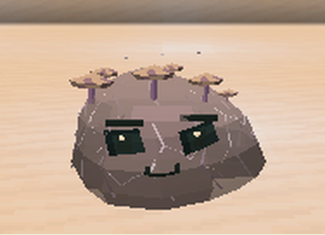

Filamentos e cogumelos espalham esporos regeneradores entre aliados.

<strong>Temperamento:</strong> Dócil <strong>Alimentos:</strong> cogumelo marrom, bloco de musgo <strong>Obtenção:</strong> Fúngico + Musgo.

<code>slimeevolution:mycelium</code>

</td>
<td valign="top" width="50%">
<h3>Slime Prismático</h3>
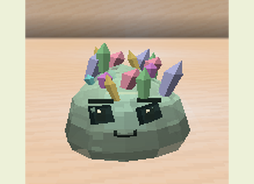

Metamorfose rara de Cristal com troféu do Colosso e alta luminosidade.

<strong>Temperamento:</strong> Neutro <strong>Alimentos:</strong> fragmento de ametista, quartzo <strong>Obtenção:</strong> Metamorfose de Cristal.

<code>slimeevolution:prismatic</code>

</td>
</tr>
<tr>
<td valign="top" width="50%">
<h3>Slime de Sculk</h3>
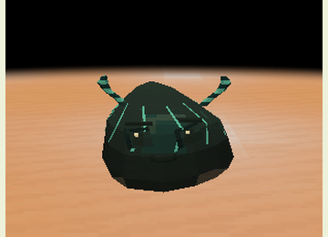

Chifres inspirados no Warden percebem movimento e respondem com pulsos de eco.

<strong>Temperamento:</strong> Hostil <strong>Alimentos:</strong> fragmento de eco, bolsa de tinta brilhante <strong>Obtenção:</strong> Metamorfose de Corrompido.

<code>slimeevolution:sculk</code>

</td>
<td valign="top" width="50%">
<h3>Slime Solar</h3>
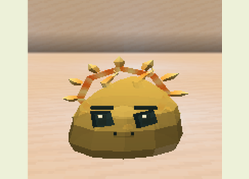

Um núcleo branco-dourado sustenta raios de fogo e recuperação ao sol.

<strong>Temperamento:</strong> Neutro <strong>Alimentos:</strong> pó de blaze, cenoura dourada <strong>Obtenção:</strong> Metamorfose de Fogo.

<code>slimeevolution:solar</code>

</td>
</tr>
<tr>
<td valign="top" width="50%">
<h3>Slime de Vapor</h3>
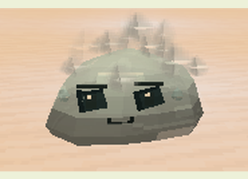

Híbrido de Fogo e Água que obscurece a visão do inimigo.

<strong>Temperamento:</strong> Dócil <strong>Alimentos:</strong> alga, pó de blaze <strong>Obtenção:</strong> Fogo + Água.

<code>slimeevolution:steam</code>

</td>
<td valign="top" width="50%">
<h3>Slime de Tempestade</h3>
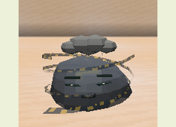

Mistura correntes de ar com descargas elétricas.

<strong>Temperamento:</strong> Hostil <strong>Alimentos:</strong> redstone, pena <strong>Obtenção:</strong> Elétrico + Vento.

<code>slimeevolution:storm</code>

</td>
</tr>
<tr>
<td valign="top" width="50%">
<h3>Slime Supercélula</h3>
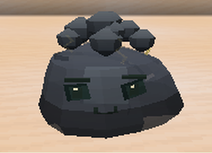

Uma nuvem madura com anéis de vento e descargas encadeadas.

<strong>Temperamento:</strong> Hostil <strong>Alimentos:</strong> redstone, pena <strong>Obtenção:</strong> Metamorfose de Tempestade.

<code>slimeevolution:supercell</code>

</td>
<td valign="top" width="50%">
<h3>Slime de Chama Volátil</h3>
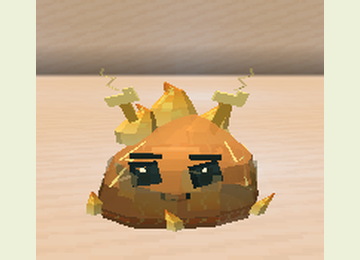

Vento e Fogo combinam rajada em chamas, imunidade ao fogo e fraqueza à água.

<strong>Temperamento:</strong> Hostil <strong>Alimentos:</strong> pó de blaze, pena <strong>Obtenção:</strong> Vento + Fogo.

<code>slimeevolution:volatile_flame</code>

</td>
</tr>
</table>
