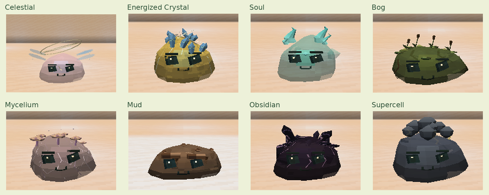
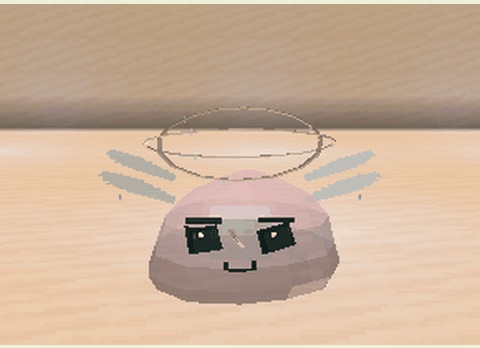
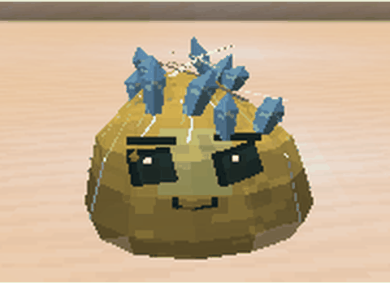
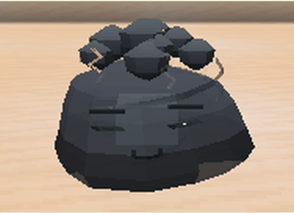

# Slime Materials and Identity

Each species keeps its body shape, core, and expressions. Materials, accessories, and movement communicate its element, even while idle. Gel color still follows genetics.

| Slime | Appearance and movement |
|---|---|
| Celestial | Translucent gel, three internal constellations, two tilted orbiting rings, and two pairs of luminous wings with star tips |
| Energized Crystal | Twelve differently sized crystals, connecting arcs, and pulsing energy veins |
| Soul | Blue spirit flames, three small eyed souls inside the body, and soft side mist |
| Bog | Branching roots, varied cattails, floating vegetation, and slow bubbles |
| Mycelium | Branching white and lilac filaments, mushrooms at different growth stages, and subtle spores |
| Mud | Wet reflections, slow drips, clay volumes, landing splashes, and slower gel animation |
| Obsidian | Dark volcanic glass plates, irregular fractures, and purple edge highlights |
| Supercell | Three spiraling cloud layers, lightning between body and clouds, and a narrow ground-level tornado |

Images are real gameplay captures, cropped, resized, and captioned. Each GIF uses four frames of the same individual separated by ten ticks.

`reducedMotion` in `config/slimeevolution-client.toml` stops decorative animations. Particles remain bounded by [client and server settings](../CONFIGURATION.md).
