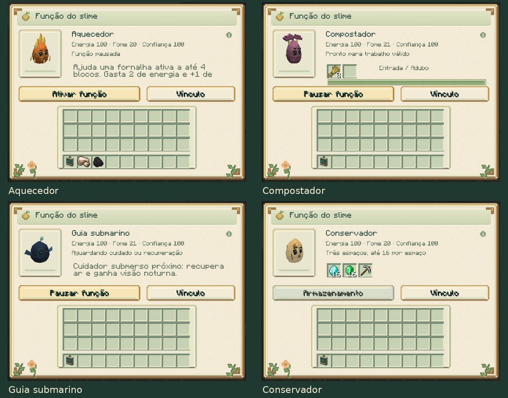
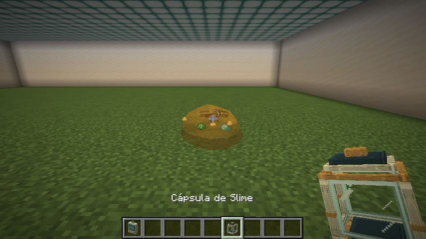

# Funções individuais dos slimes

[Guia do mod](../README.md) · [Vínculo e treinamento](COMPANIONS.md)

O painel oferece **19 funções individuais**. Fogo, Fúngico, Abyssal e Âmbar
estão detalhados nesta página. Para Ferro, Comum, Água, Luminoso, Almas, End,
Void, Cáustico, Lunar, Colmeia e Aurora, consulte [produção, transporte e auras](WORK_JOBS.md).

Elétrico, Cristal, Cristal Energizado e Vidro estão no
[guia de circuitos, sonar e vitrine](SIGNAL_JOBS.md).

## Acessar a função

Agache e use o **analisador genético no seu slime**, depois pressione **Função**
no painel de vínculo. O acesso continua restrito ao cuidador próximo, com visão
livre e permissão de construção. As funções começam desligadas nos indivíduos
novos e nos saves antigos.

Fogo, Fúngico e Abyssal precisam ser adultos e estar calmos, com confiança de
pelo menos 40, energia de pelo menos 30, fome de no máximo 60 e conforto de pelo
menos 40. Ative a função e mantenha os cuidados. Dano, combate, reprodução,
laços, passageiros e necessidades inadequadas podem interromper o trabalho.
O ícone de informação explica os custos ao passar o mouse.

## Fogo: aquecedor

Coloque o slime a até **quatro blocos** de uma fornalha, alto-forno ou defumador,
com visão livre até o bloco, e use a ordem **Livre ou Esperar**. O cuidador precisa
estar online na mesma dimensão e ter permissão para alterar o local.

A cada segundo, um slime disponível acrescenta **até 20 ticks de preparo** a um
processamento que já tenha aceitado combustível, receita e espaço na saída.
Cada pulso custa **2 de energia e acrescenta 1 de fome**. A recuperação de
20 ticks é do ajudante: várias fornalhas não podem reutilizá-lo simultaneamente,
e vários slimes não multiplicam os pulsos da mesma fornalha naquele segundo.

A fornalha conserva combustível, ingredientes, resultados, receitas e XP
normais. O slime não inicia uma fornalha sem combustível nem gasta energia
quando a receita ou a saída estão bloqueadas. O último tick e a entrega do
resultado continuam sob responsabilidade da fornalha. A ação respeita
`mobGriefing` e o evento de permissão de interferência de entidades do NeoForge.

## Fúngico: compostador

No painel de função, coloque **oito itens compostáveis iguais no primeiro
espaço**. São aceitos os itens da compostagem do Minecraft, como sementes,
folhas, plantas e alimentos vegetais. O segundo espaço é a saída.

Após **200 ticks de trabalho carregado** — dez segundos a 20 ticks/s — o slime
consome oito unidades e produz **uma farinha de osso**, usada como adubo.
A conclusão custa **6 de energia e acrescenta 3 de fome**. O processamento
pode acompanhar o slime durante uma ordem Seguir.

Os espaços comportam até 16 itens. Sem oito entradas válidas ou com a saída
cheia, o ciclo reinicia sem cobrar materiais ou energia. Pausar a função ou
perder condições de cuidado conserva o progresso, que também fica salvo ao
capturar ou descarregar o slime. É possível retirar o adubo normalmente,
inclusive com Shift. Não é possível inserir itens no espaço de saída.

## Abyssal: guia submarino

Ative a função e mantenha **o cuidador e o slime com os olhos submersos**, a até
**seis blocos**, com visão livre entre eles. O guia funciona também enquanto
segue o cuidador com uma ordem aprendida.

Quando necessário, uma ação recupera **até 60 pontos de ar** e concede ou renova
**15 segundos de visão noturna**. Isso permite enxergar o caminho subaquático
sem colocar fontes de luz no mundo. O auxílio atende somente o próprio cuidador.

Cada ação custa **2 de energia e acrescenta 1 de fome**, com **40 ticks de
recuperação**: dois segundos a 20 ticks/s. Ar completo e visão noturna ainda
recente não gastam recursos. Efeitos de visão noturna existentes com duração
maior são preservados. Ao sair da água, o efeito já concedido termina pelo seu
tempo normal; novos auxílios exigem que ambos continuem submersos.

## Âmbar: conservador

O painel oferece **três compartimentos**, cada um com **até 16 itens**,
respeitando o limite normal do objeto. Uma ferramenta continua ocupando um
espaço com uma unidade. A confiança mínima para novos depósitos é 40.

Os objetos guardados aparecem dentro do corpo do slime. Quando está vazio,
ele conserva as inclusões decorativas de graveto, pedra e picareta. O
armazenamento não consome energia e não exige ativar um ciclo de trabalho.

Cápsulas, bolsas, caixas de shulker e itens com inventários incorporados não são
aceitos. Transferências com Shift preservam o excedente no inventário do jogador.

## Persistência, retirada e configuração

Os pertences, a preferência de trabalho, a recuperação e o progresso de
compostagem acompanham o indivíduo no save e na cápsula. A captura não derruba
os itens; eles voltam com o mesmo slime na soltura. A morte derruba os pertences
uma vez. Filhotes começam com inventário vazio e sem função ativada.

Metamorfoses preservam os pertences. Se a nova espécie não possuir uma função,
o botão permanece disponível enquanto houver itens, permitindo retirá-los.
O menu anterior fecha ao mudar de espécie; novos depósitos seguem as regras
da espécie atual.

O servidor pode desligar `companions.specializations` nas
[configurações](../CONFIGURATION.md). Isso pausa funções e novos depósitos.
O cuidador continua podendo retirar seus itens ou cancelar a ativação armazenada,
inclusive com confiança abaixo de 40. As recuperações avançam apenas enquanto
o indivíduo está carregado. Não há carregamento de chunks para executar funções.
