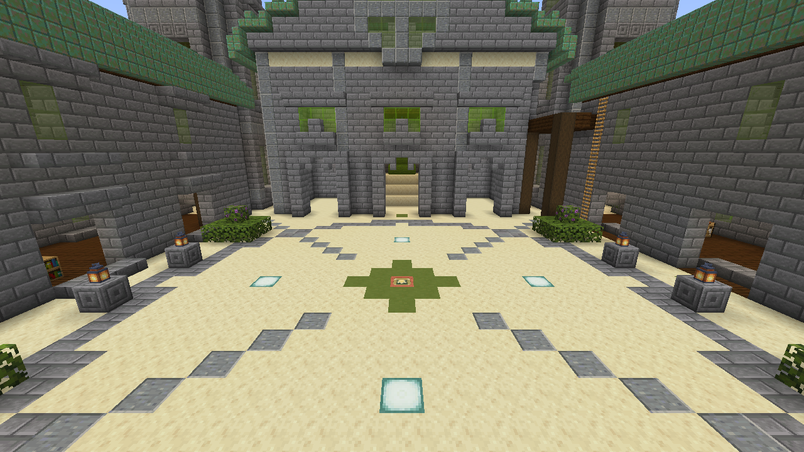
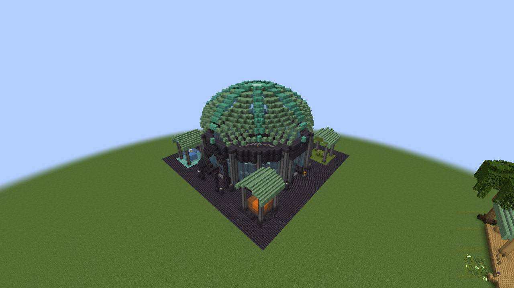
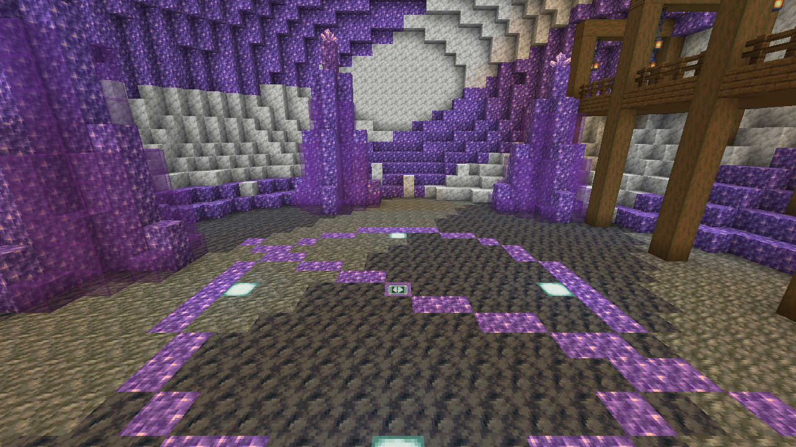
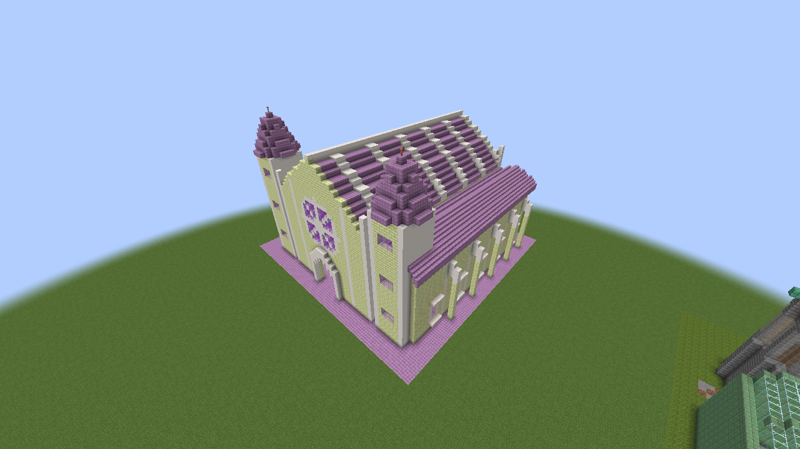
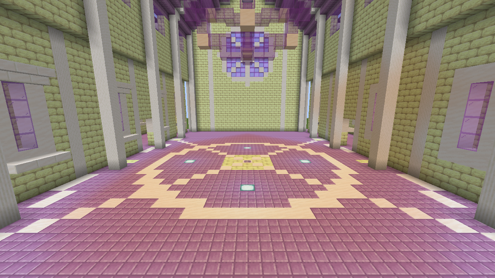
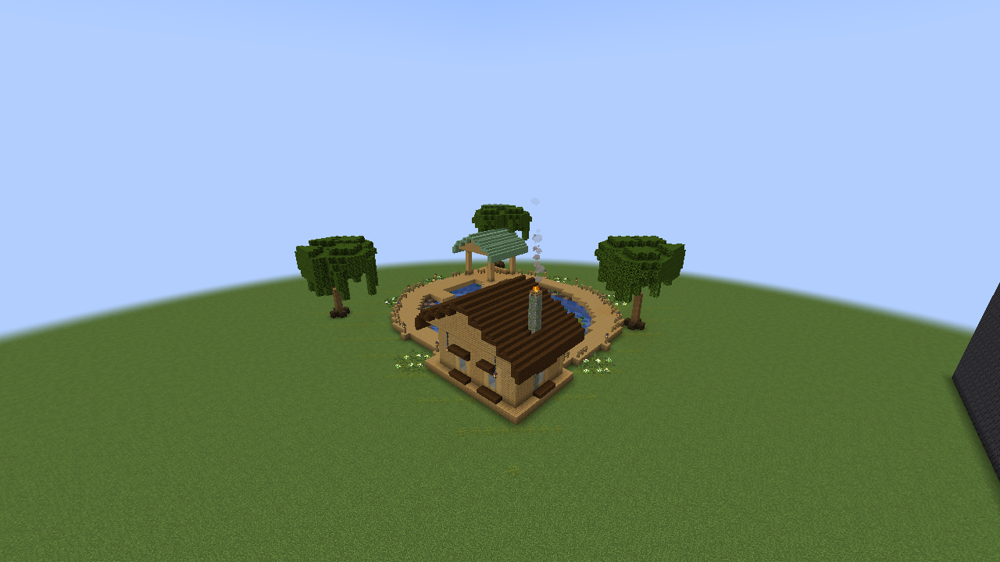
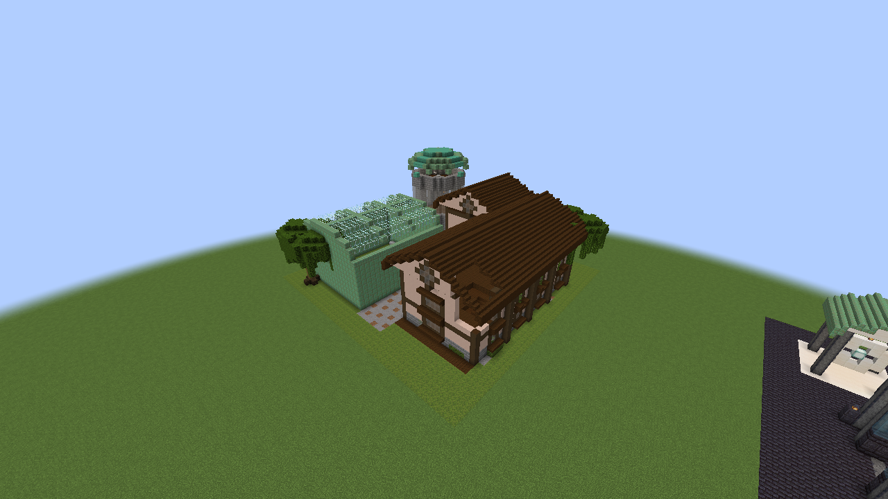
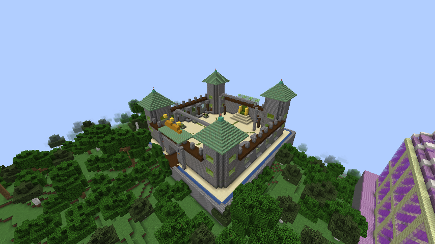

# Structures and Natural Arenas

Six structures generate in **new chunks** when structure generation is enabled. Each has its own architecture, materials, lighting, and SolarPunk details.

| Structure ID after `slimeevolution:` | Allowed biomes | Contents |
|---|---|---|
| `royal_court` | Plains, Sunflower Plains, Swamp | 53×53×53 court with four towers, raised galleries, recessed windows, green glazing, processional arches, throne, gardens, and moat. Gelatinous King altar. |
| `elemental_sanctuary` | Plains, Desert, Savanna | 53×42×53 temple with a copper-and-glass dome, colonnades, oculus, and four elemental shrines. Magmatic Heart altar. |
| `crystal_cavern` | Stony Peaks, Dripstone Caves, Plains, Forest | 49×39×49 geode with giant crystals, mineral bands, stalactites, and a stair-accessible expedition gallery. Crystalline Colossus altar. |
| `ancestral_chamber` | End Highlands, End Midlands | 53×49×53 chamber with a high vault, buttresses, side galleries, rose window, and a large three-axis orrery. Primordial Slime altar. |
| `gelatinous_lake` | Swamp, Mangrove Swamp, Plains | 49×29×49 lake with organic banks, a boardwalk loop, visible stilts, fishing pier, a covered cabin, a smaller pavilion, and slime islets. |
| `researcher_ruins` | Plains, Forest, Taiga | 49×39×49 campus with a two-story library, mezzanine, glazed conservatory, laboratory, observatory, and overgrown ruins. |

## Summon at an altar

The four arenas have central engraved pedestals and **17×17 floor space with six clear blocks above**.

| Arena | Ritual item | Boss |
|---|---|---|
| Royal Court | Gelatinous Crown | Gelatinous King |
| Elemental Sanctuary | Magma Brazier | Magmatic Heart |
| Crystal Cavern | Crystal Sigil | Crystalline Colossus |
| Ancestral Chamber | Primordial Seal | Primordial Slime |

Structures start without bosses. An accepted Survival summon consumes one item. The altar remains reserved until that boss dies, including across unloading and server restarts. Rejected uses do not consume ritual items. After victory, the altar can be reused. Ordinary floors cannot start rituals.

In 0.21.0, side clicks also work. Standing on the pedestal or bringing followers no longer automatically blocks the ritual: the boss uses a free nearby position inside the arena. If every position is occupied, the item is preserved and feedback explains the missing space. Rituals remain unavailable on Peaceful difficulty.

## Arena protection

All four boss arenas remain protected before, during, and after fights, including in Creative. Protection covers the structure, foundations, and an outer margin. It blocks breaking, placement, fluid changes, explosion damage to blocks, pistons, and indirect terrain changes from fire, dispensers, falling blocks, fluids, or mobs.

Altars, chests, and reward collection remain accessible. Attacks and explosions can still affect entities. Protection persists independently of structure-generation settings. Lakes and researcher ruins are unprotected exploration sites.

## Exploration and frequency

Each structure contains one finite loot chest; opening, emptying, or reloading it does not refill it. The Ancestral Chamber supplies an **Ancient Tablet** for the Primordial Seal. Loot does not automatically reveal Slimepedia entries.

Crystal caverns are underground without an excavated entrance tunnel. Surface sites reject unsuitable oceans, steep terrain, and low islands. There is no retroactive generation: explore new terrain for updated structures and altars.

Structure sets use `random_spread`, spacing 32 and separation 12 chunks; the chamber uses 24 and 8. Biome, height, slope, and rarity filter candidates, so spacing does not guarantee a structure at every interval. Server settings control overall and individual generation plus rarity.

With commands enabled, use `/locate structure slimeevolution:royal_court` in the Overworld or `/locate structure slimeevolution:ancestral_chamber` in the End. Substitute other IDs as needed. Datapack `has_<id>` tags can extend allowed biomes.

[Bosses](BOSSES.md) · [Configuration](../CONFIGURATION.md)

## 0.22.0 architecture gallery

All six builds are original. Visual research examined facade depth, repeated bays, material hierarchy, circulation, and integrated vegetation in Repurposed Structures: [Jungle Fortress](https://github.com/TelepathicGrunt/RepurposedStructures/blob/26.3/images/FortressJungle2.png), [Oak Mansion](https://github.com/TelepathicGrunt/RepurposedStructures/blob/26.3/images/MansionWitchHutOak.png), [End Ancient City](https://github.com/TelepathicGrunt/RepurposedStructures/blob/26.3/images/AncientCityEnd.png), and [Flower Forest Pyramid](https://github.com/TelepathicGrunt/RepurposedStructures/blob/26.3/images/PyramidFlowerForest.png). No external templates were copied.

The images below are in-game captures in a flat review meadow. Natural placement follows the biome and slope rules above. Foundations are eight blocks deep, and each build retains one finite reward chest with an accessible interior route. Arenas retain their clear ritual floors.

### Royal Court

### Elemental Sanctuary

### Crystal Cavern

### Ancestral Chamber

### Gelatinous Lake

### Researcher Ruins

## Building workflow and comparison

Version 0.22.0 uses the [Minecraft Builder skill](https://github.com/wzhaoMS/minecraft-builder-skill/blob/b389252c0cc07a673677f818622b50dda578228b/SKILL.md) and its [building guide](https://github.com/wzhaoMS/minecraft-builder-skill/blob/b389252c0cc07a673677f818622b50dda578228b/docs/building-guide.md): distinct volumes and roofs, recessed facades, consistent materials, circulation between floors, and review in isometric previews and in the game. This is an authoring tool, not a mod dependency.

Royal Court in 0.21.0:

Royal Court in 0.22.0:

