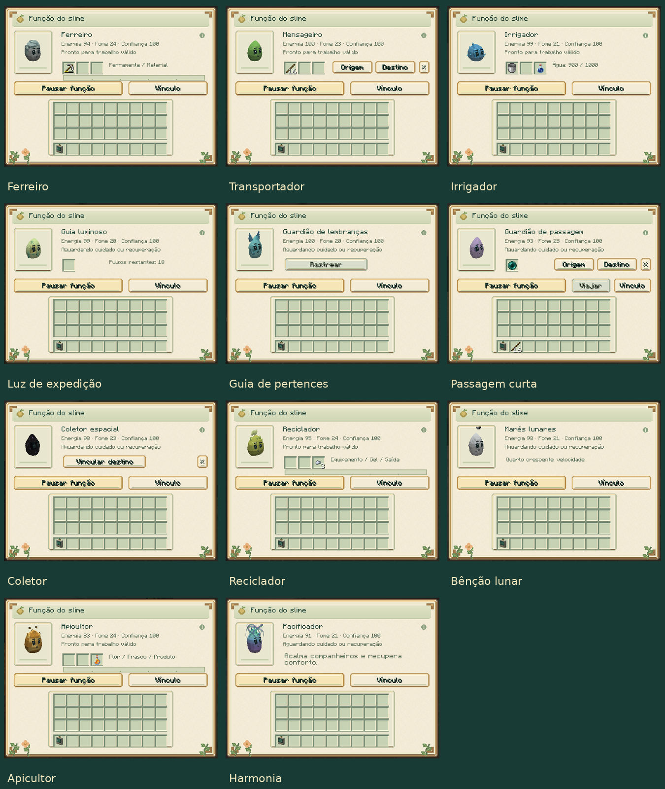

# Produção, transporte e auras

[Guia do mod](../README.md) · [Funções individuais](SPECIALIZATIONS.md) · [Treinamento](COMPANIONS.md)

Agache e use o analisador no seu slime; abra **Função**. Todos os trabalhos
começam pausados. Os requisitos de cuidado são os mesmos das funções iniciais:
adulto calmo, confiança 40, energia 30, fome até 60 e conforto 40.
As funções abaixo acrescentam um requisito de treino quando indicado.
Os números da coluna Treino são pontos de experiência obtidos nas lições.

| Slime | Função | Treino | Recursos e custo por ação |
|---|---|---:|---|
| Ferro | Ferreiro | 0 | Material de reparo; 6 de energia, +3 de fome |
| Comum | Mensageiro | 20 | Baús vinculados; 2 de energia, +1 de fome por retirada ou entrega |
| Água | Irrigador | 0 | Água armazenada; 2 de energia, +1 de fome |
| Luminoso | Guia luminoso | 0 | Pó de glowstone; 1 de energia por pulso |
| Almas | Guardião de lembranças | 20 | Última morte registrada; 1 de energia a cada 2 s |
| End | Guardião de passagem | 60 | Uma pérola; 12 de energia, +4 de fome por viagem |
| Void | Coletor espacial | 40 | Baú ou Âmbar vinculado; 2 de energia, +1 de fome |
| Cáustico | Reciclador | 20 | Equipamento e bola de slime; 6 de energia, +3 de fome |
| Lunar | Marés lunares | 20 | Efeito necessário no cuidador; 3 de energia, +1 de fome |
| Colmeia | Apicultor | 0 | Flor e, opcionalmente, frasco; 6 de energia, +3 de fome |
| Aurora | Pacificador | 20 | Companheiros próximos; 3 de energia, +1 de fome |

## Ferro: reparar equipamento

Coloque a ferramenta ou armadura no primeiro espaço e um material compatível
no segundo. Após **10 segundos de trabalho**, consome um material e recupera
**25% da durabilidade máxima**. Nome e encantamentos são preservados.
O equipamento permanece no primeiro espaço para retirada ou outro ciclo.
Materiais incorretos e itens já reparados não geram cobrança.

São aceitos os materiais normais de reparo disponíveis no painel, incluindo
ferro, ouro, diamante, netherita, pedregulho, tábuas, couro, escama de tartaruga
e membrana de phantom, conforme o equipamento.

## Comum: transportar entre estações

1. No painel, pressione **Origem**.
2. Agache e use o analisador no baú ou barril escolhido, mantendo o slime próximo.
3. Abra novamente o painel e repita com **Destino**.
4. Ative a função e escolha a ordem **Livre**.

As estações devem ficar na mesma dimensão e a até **32 blocos entre si**.
O slime usa caminhos e saltos normais. Retira até 16 itens por operação,
carrega-os nos próprios compartimentos e entrega quando está a até três
blocos do destino. Cada retirada ou entrega custa energia e aumenta a fome.

Saída cheia conserva a carga no slime. Você pode retirar os pertences pelo
painel. **Seguir, Esperar ou Voltar ao lar** pausam a rota de trabalho.
O botão **×** limpa os vínculos e pausa sem apagar a carga.

## Água: irrigar e encher frascos

Um balde de água no primeiro espaço enche o reservatório com **1000 unidades**
e devolve o balde vazio. A cada segundo, pode hidratar um bloco de plantação
visível a até quatro blocos, gastando **25 unidades**.

Com frascos no segundo espaço e saída livre no terceiro, enche um frasco de
água por **100 unidades**. Frascos têm prioridade sobre irrigação.
O reservatório acompanha o indivíduo ao salvar ou usar uma cápsula.

## Luminoso: iluminar o caminho

Coloque pó de glowstone no primeiro espaço e ative. Cada unidade fornece
**20 pulsos**, um por segundo. O slime ilumina seu caminho e o de seu cuidador
quando próximo, a até seis blocos. Cada pulso custa uma energia.

As luzes são temporárias e não substituem blocos existentes. Sem renovação,
somem em até três segundos carregados; a remoção agendada continua depois
que a região é carregada novamente. Pausar, capturar ou perder o slime não
transforma o caminho em iluminação permanente.

## Almas: localizar a última morte

Ative perto do cuidador. O slime mostra a dimensão e as coordenadas da última
morte, aponta a direção com partículas e destaca até três pilhas próximas
marcadas como pertences perdidos desse jogador. O botão **Rastrear** consulta
o mesmo ponto pelo painel, respeitando a recuperação de dois segundos.

A direção aparece apenas na mesma dimensão. A função localiza os objetos
que ainda existem no mundo; não recria itens perdidos ou desaparecidos.

## End: viajar entre âncoras

Vincule **Origem** e **Destino** pelo analisador, selecionando o piso de cada
âncora. As duas precisam estar na mesma dimensão e a até **32 blocos**.
Coloque pérolas no primeiro espaço, ative e fique a até quatro blocos de uma
âncora. Pressione **Viajar**: cuidador e slime vão para a outra.

Cada viagem consome uma pérola, 12 de energia e acrescenta quatro de fome,
com recuperação de dez segundos. É preciso espaço livre e piso seguro para
ambos. Destino bloqueado, perigoso ou descarregado não consome a pérola.
O botão **×** permite apagar os vínculos para configurar outra passagem.

## Void: recolher itens

Pressione **Vincular destino**, depois agache e use o analisador num baú,
barril ou Âmbar do mesmo cuidador. Ative com o destino próximo.
A cada segundo, transfere até 16 itens de uma pilha no chão, a até seis blocos,
com visão livre até a pilha e o destino.

Se só houver espaço para parte da pilha, o restante fica no chão. Não recolhe
cápsulas, itens com inventários incorporados, pilhas em espera para coleta
nem pertences identificados de outros jogadores. Sem espaço, não cobra.

## Cáustico: reciclar metal

Primeiro espaço: equipamento de ferro, ouro ou cota de malha.
Segundo: bola de slime. Terceiro: saída.
Após dez segundos, consome o equipamento e uma bola de slime, devolvendo
até **25% do metal em pepitas**, proporcional à durabilidade restante e
limitado a 16 pepitas por ciclo. Encantamentos não são transferidos.
Sem rendimento mínimo ou espaço na saída, nada é consumido.

## Lunar: benefício da fase

A fase individual agora também determina um benefício para o cuidador a até
seis blocos, com visão livre. Ative para permitir as renovações.

| Fase | Benefício |
|---|---|
| Cheia | Regeneração I quando ferido |
| Gibosa minguante | Resistência I |
| Quarto minguante | Pressa I |
| Minguante | Remove veneno e fome |
| Nova | Invisibilidade |
| Crescente | Salto I |
| Quarto crescente | Velocidade I |
| Gibosa crescente | Visão noturna |

Os efeitos duram 15 segundos; a recuperação entre ações é de cinco segundos.
Uma renovação custa três de energia e acrescenta um de fome, sendo cobrada
apenas quando traz benefício. Um efeito mais forte já existente é preservado.
As [fases e os comandos](CELESTIAL_VISUALS.md) continuam disponíveis.

## Colmeia: mel, favos e polinização

Mantenha uma flor plantada visível a até quatro blocos. Na ordem Livre, o slime
pode procurar flores próximas. Coloque uma flor no primeiro espaço:
após dez segundos, ela vira um favo. Com frasco no segundo espaço, o resultado
é mel engarrafado. A saída fica no terceiro espaço.

Cada ciclo também pode avançar uma etapa de uma plantação próxima, quando
permitido. Saída cheia ou falta de flor interrompem o processamento sem cobrar.

## Aurora: acalmar o curral

A cada cinco segundos, ajuda até **três slimes do mesmo cuidador**, a até seis
blocos e com visão livre. Cada ajudado recebe quatro de conforto e sete
segundos de calma, reduzindo agressão espontânea e retaliação entre companheiros.
A autodefesa contra inimigos continua disponível.

Cada ação útil custa três de energia e acrescenta um de fome. Companheiros
com conforto máximo e calma recente não geram uma nova cobrança.

## Transporte e controle

Materiais, cargas, reservatórios, recuperação e vínculos acompanham o indivíduo
no save e na cápsula. Uma metamorfose pausa a função anterior; retire pertences
e configure o trabalho da nova espécie. Morte derruba os objetos guardados.

As funções respeitam a configuração do servidor e os controles de acesso.
Interações com terreno e estações usam as permissões do cuidador e a regra
`mobGriefing`. O trabalho usa apenas entidades e regiões carregadas.
