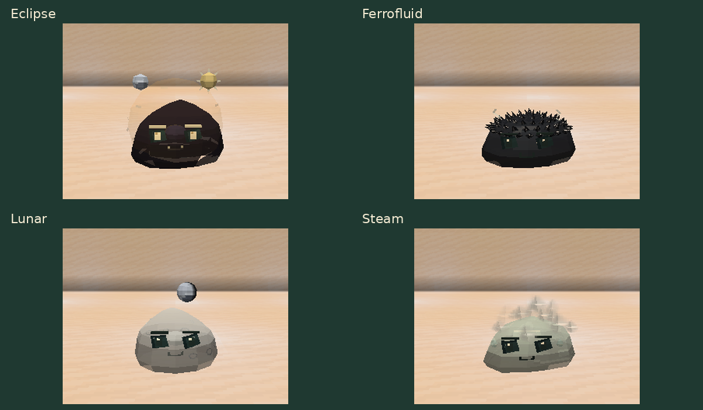

# Slime Evolution 0.10.0

[Atualizações por versão](README.md) · [Guia do mod](../README.md)

Quatro slimes recebem novos detalhes:

- **Eclipse:** aura esférica ao redor do corpo; o disco das costas dá lugar ao Sol e à Lua orbitando acima.
- **Ferrofluid:** 72 espinhos pequenos cobrem o topo da cabeça.
- **Lunar:** oito fases possíveis, com uma lua flutuando em órbita sobre o slime. Cada indivíduo conserva sua fase no save e ao entrar ou sair de uma cápsula.
- **Steam:** fumaça suave saindo de 14 pontos distribuídos pela superfície, com subida, expansão e dissipação.

As variantes lunares são cosméticas e independentes da fase da lua do mundo.
Indivíduos antigos recebem uma fase estável pela identidade; as oito opções
não criam espécies novas nem alteram genética ou habilidades.

[Galeria e comandos](../guides/CELESTIAL_VISUALS.md) ·
