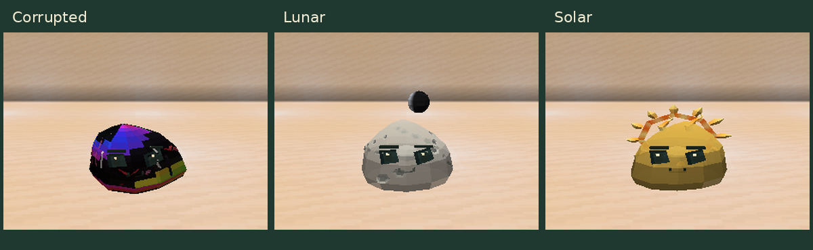

# Slime Evolution 0.11.0

[Atualizações por versão](README.md) · [Guia do mod](../README.md)

- **Corrupted:** o corpo ganha uma textura escura com manchas iridescentes que se movem e se misturam, mantendo as fissuras coloridas.
- **Lunar:** 20 crateras com bordas claras e centros sombreados se distribuem pelo topo, lados e costas, preservando o espaço do rosto.
- **Solar:** os raios e a coroa giram lentamente; os raios pulsam e o plasma da coroa ondula.

As oito fases e a lua flutuante do Lunar continuam disponíveis. Os detalhes são
cosméticos e respeitam a opção de movimento reduzido.

[Imagens e trechos animados](../guides/ELEMENTAL_DETAILS.md) ·
