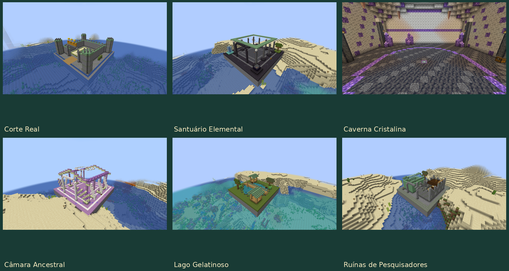
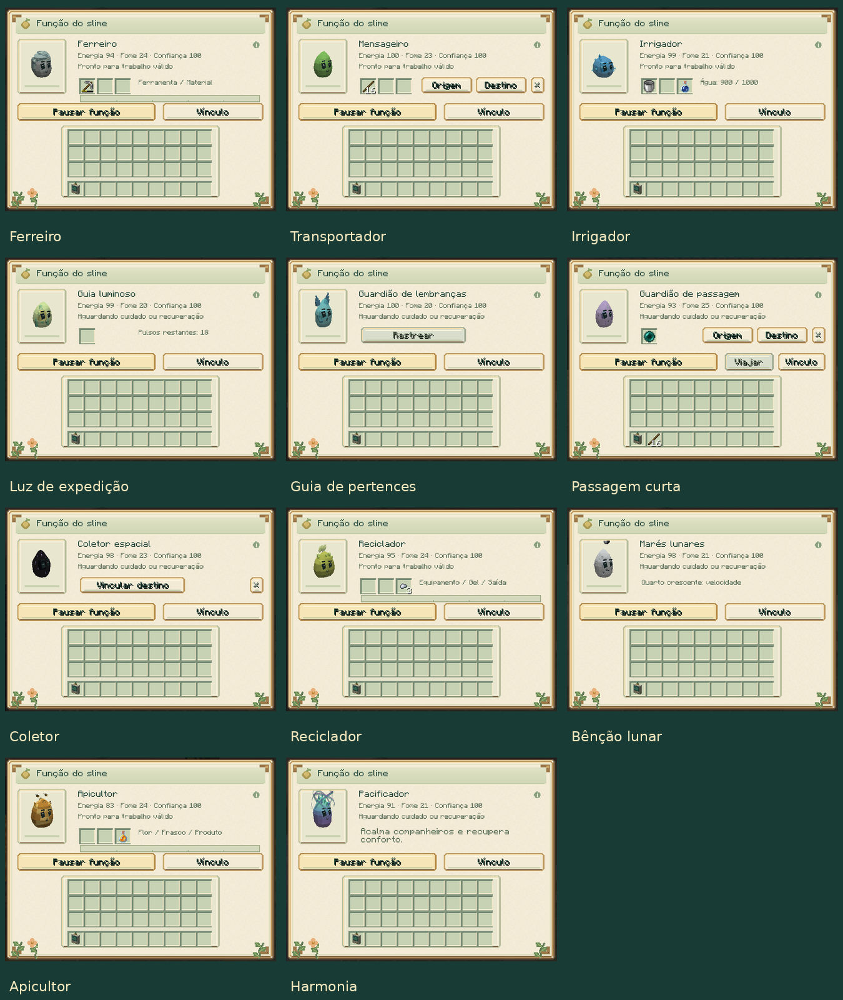

# Slime Evolution 0.12.0

[Atualizações por versão](README.md) · [Guia do mod](../README.md)

## Arenas naturais e exploração

As estruturas recebem arquitetura maior e mais detalhada, com arcos,
colunatas, passarelas, jardins, iluminação e materiais próprios. A nova
Corte Real se junta ao Santuário Elemental, Caverna Cristalina, Câmara
Ancestral, Lago Gelatinoso e Ruínas de Pesquisadores.

As quatro arenas de bosses nascem sem boss e têm um altar central. Use a
Coroa, Braseiro, Sigilo ou Selo correspondente para iniciar a luta. O altar
fica reservado durante o encontro e pode ser reutilizado após a vitória.
Quebra, construção e alterações indiretas por explosões, líquidos, fogo,
pistões, dispensadores e criaturas não modificam as arenas, inclusive em
Criativo. A proteção e a reserva da luta persistem no mundo.

As novas construções aparecem em chunks novos. Baús continuam finitos.
[Exploração e altares](../guides/SPECIAL_STRUCTURES.md).

## Onze novas funções individuais

| Slime | Função |
|---|---|
| Ferro | Repara equipamento usando material compatível. |
| Comum | Transporta cargas entre baús com navegação real. |
| Água | Irriga e enche frascos com água armazenada. |
| Luminoso | Ilumina caminhos com luz temporária alimentada por glowstone. |
| Almas | Aponta a última morte e ajuda a encontrar pertences do cuidador. |
| End | Leva cuidador e slime entre duas âncoras próximas, consumindo pérolas. |
| Void | Recolhe itens para um baú ou Âmbar vinculado. |
| Cáustico | Recicla equipamento metálico em pepitas. |
| Lunar | Concede um benefício próprio da fase individual. |
| Colmeia | Produz mel ou favos e auxilia a polinização. |
| Aurora | Recupera conforto e acalma companheiros próximos. |

Funções começam pausadas; algumas exigem treino. O analisador vincula estações
ou limpa ligações sem perder a carga. Inventários, vínculos, reservatórios e
recuperação acompanham saves e cápsulas. As quatro funções anteriores continuam
disponíveis. [Como usar as 15 funções](../guides/SPECIALIZATIONS.md).

## Cinco conquistas de linhagem

- **Eclipse:** Solar carregado, Lunar de Lua Nova, entardecer e Estilhaço Prismático.
- **Supercélula:** três raios distintos conduzidos por um para-raios.
- **Aurora:** três biomas visitados e conclusão em noite limpa na região gelada.
- **Ancestral:** Selo Primordial com troféus de três bosses, estrela e tabuleta.
- **Celestial:** confiança 80, pesquisa completa de Ancestral e três observações.

O analisador mostra os marcos e permite confirmar as observações. A receita
do Selo usa Estrela do Nether em lugar de Essência Ancestral, permitindo a
primeira obtenção sem dependência circular. [Requisitos completos](../guides/ASCENSION.md).

