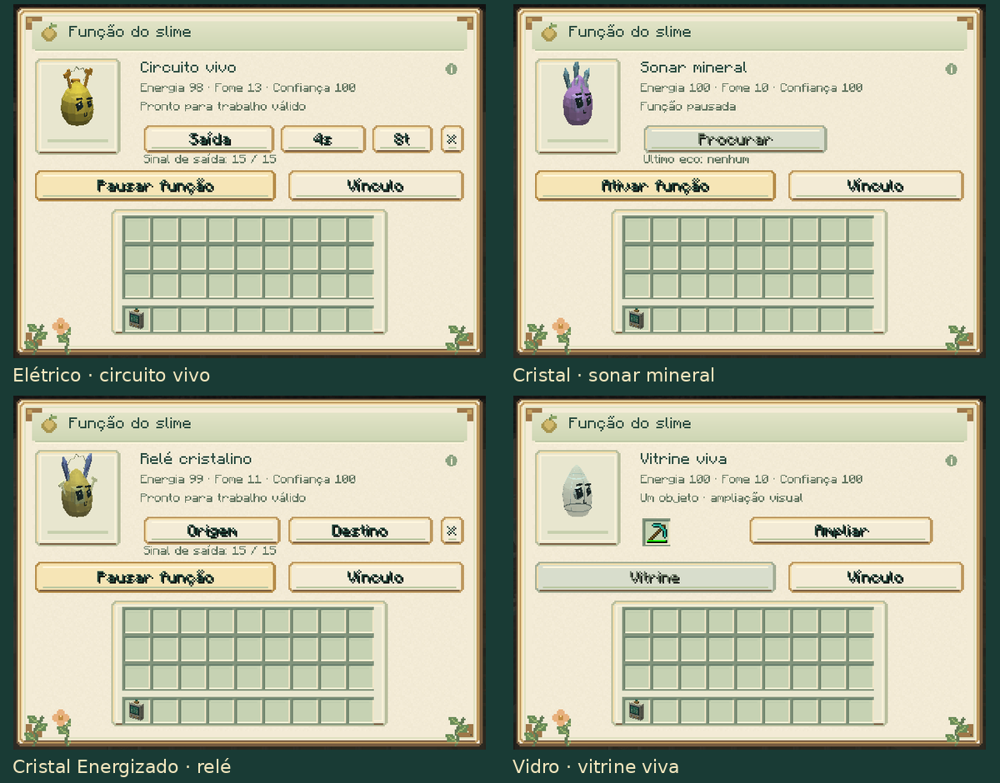

# Slime Evolution 0.13.0

[Atualizações por versão](README.md) · [Guia do mod](../README.md)

Quatro novas funções individuais elevam o total a **19**:

| Slime | Nova função |
|---|---|
| Elétrico | Pulsos de redstone com intervalo e duração ajustáveis. |
| Cristal | Sonar direcional para concentrações minerais próximas. |
| Cristal Energizado | Transmissão de sinais analógicos entre entrada e saída vinculadas. |
| Vidro | Vitrine com um objeto real girando dentro do corpo e opção de ampliar a exibição. |

As configurações, vínculos, recuperação e objetos acompanham saves e cápsulas.
Os circuitos usam redstone normal, respeitam as arenas e se desligam quando
sua fonte deixa de estar disponível. A vitrine preserva os componentes do item.

[Como usar as quatro funções](../guides/SIGNAL_JOBS.md) ·
