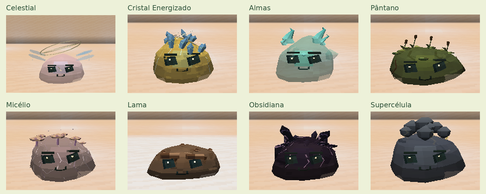

# Slime Evolution 0.14.0

[Atualizações por versão](README.md) · [Guia do mod](../README.md)

Oito espécies receberam materiais, detalhes e animações para representar melhor
sua identidade, preservando o formato dos corpos e as expressões:

- **Celestial:** constelações internas, anéis orbitais e asas de luz.
- **Cristal Energizado:** coroa de cristais, veios pulsantes e arcos de energia.
- **Almas:** pequenos espíritos internos, chamas azuladas e névoa.
- **Pântano:** raízes, taboas, vegetação flutuante e bolhas.
- **Micélio:** filamentos ramificados, cogumelos de tamanhos variados e esporos.
- **Lama:** superfície úmida, gotas lentas e respingos na aterrissagem.
- **Obsidiana:** placas escuras de vidro vulcânico, fraturas e reflexos nas bordas.
- **Supercélula:** nuvens em camadas, relâmpagos e tornado concentrado na base.

Os movimentos usam o GeckoLib e as superfícies animadas do mod. As novas
animações respeitam a opção de movimento reduzido e o limite de partículas.

[Guia ilustrado](../guides/SLIME_IDENTITIES.md) ·
