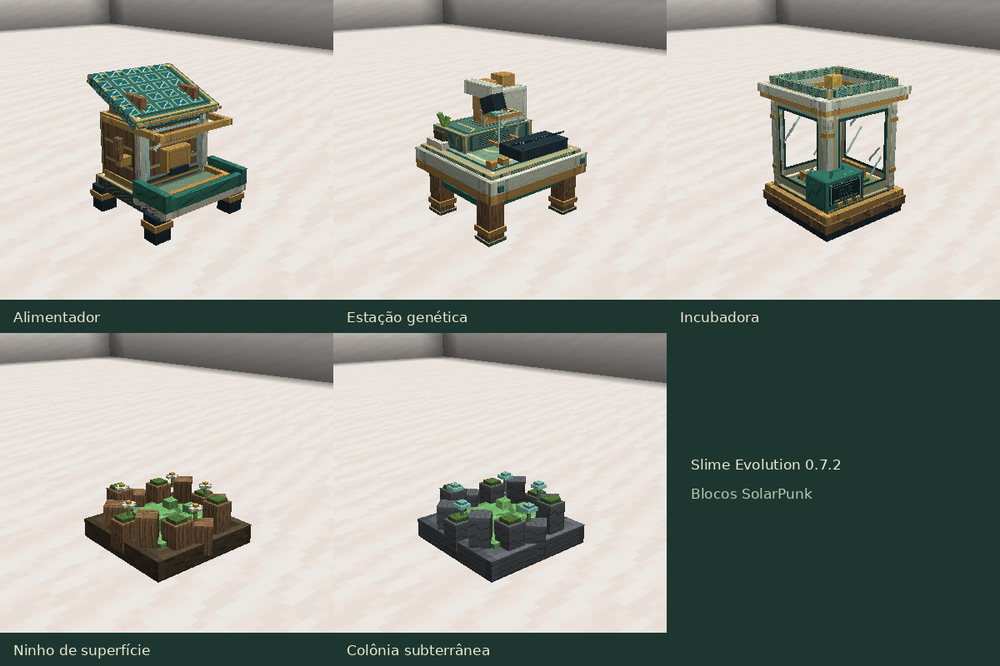

# Slime Evolution 0.7.2

[Atualizações por versão](README.md) · [Guia do mod](../README.md)

Os blocos receberam modelos com volume e materiais SolarPunk: madeira, cerâmica,
latão, vidro e vegetação. O alimentador tem reservatório, bandeja frontal,
alavanca e cobertura solar inclinada. A estação genética virou uma bancada
com microscópio, cartucho de pesquisa, controles e um pequeno vaso. A incubadora
tem câmara envidraçada, berço interno, bobinas e console frontal.

As três máquinas ficam voltadas para o jogador ao serem colocadas, com colisões
ajustadas aos novos formatos. Os monitores da estação e da incubadora animam
enquanto o processamento realmente avança; ficam parados ao pausar ou concluir.
Detalhes emissivos permanecem legíveis no escuro.

Ninhos de superfície têm raízes, musgo, flores e gel; colônias subterrâneas
combinam pedras, gel e fungos luminosos. As mesmas formas aparecem nos itens
das máquinas, no inventário e nas mãos.

Receitas, custos e duração dos trabalhos permanecem iguais. Blocos antigos
carregam voltados para o norte; os inventários são preservados. O catálogo
continua com 47 espécies.

