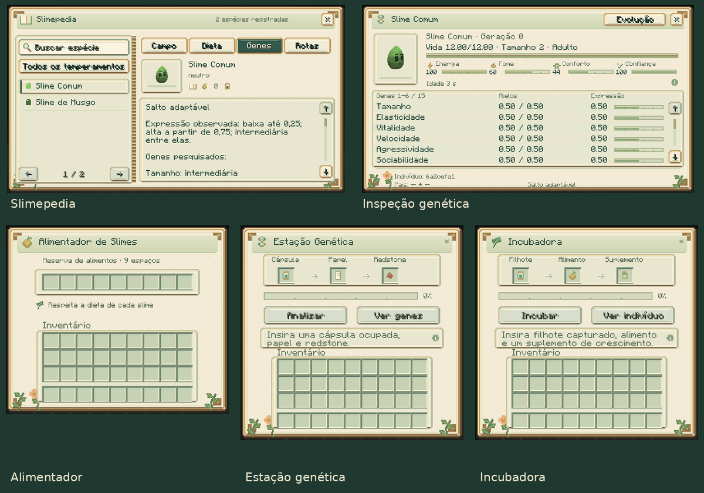

# Slime Evolution 0.7.3

[Atualizações por versão](README.md) · [Guia do mod](../README.md)

As cinco interfaces receberam um novo acabamento SolarPunk, com papel
texturizado, molduras em cobre e latão, placas em verde-sálvia, detalhes
botânicos, ícones próprios e slots rebaixados. Botões de ação, seleção, foco
e indisponibilidade têm apresentações distintas.

A Slimepedia ganhou páginas com lombada, índice de espécies, abas destacadas,
marcadores de pesquisa e uma prévia 3D da espécie observada. Busca, filtros,
rolagem e navegação continuam disponíveis. A pesquisa permanece privada.

A inspeção genética reúne a prévia do indivíduo, vida e necessidades em barras,
uma tabela de alelos e expressão com indicadores e a consulta dos requisitos
de evolução. Informações de crescimento, recuperação, estabilização e linhagem
ficam organizadas junto aos respectivos detalhes ao passar o mouse.

Estação e incubadora mostram entradas identificadas por ícones, percentual
de progresso, ações destacadas e mensagens de estado em uma placa própria.
O alimentador ganhou espaço entre o cabeçalho, os nove slots de alimento
e o inventário do jogador.

As telas do diário e da inspeção ajustam o espaço à janela. Foram conferidas
em português e inglês, incluindo janela 640×480 com escala de interface 2.

