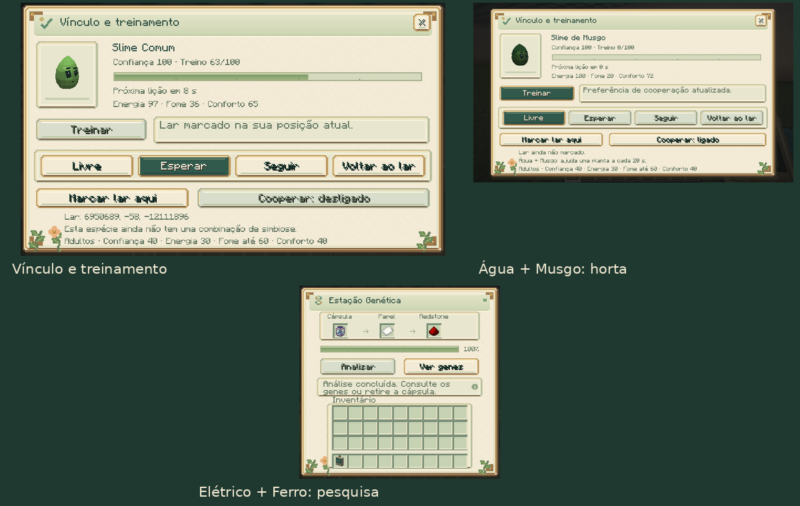

# Slime Evolution 0.8.0

[Atualizações por versão](README.md) · [Guia do mod](../README.md)

O cuidador agora pode abrir um painel de vínculo ao agachar e usar o analisador
genético no próprio slime. Lições consomem energia, aumentam a fome e ensinam
os comandos Esperar, Seguir e Voltar ao lar. Sociabilidade e estabilidade
influenciam o ritmo de aprendizagem. O lar pode ser marcado na posição do jogador.

As ordens usam a navegação e os saltos normais, com prioridade à autodefesa.
Experiência, lar, preferências e recuperações acompanham o indivíduo no save,
na cápsula e nas metamorfoses. O aprendizado não é herdado pelos filhotes.

Duas combinações de simbiose estão disponíveis: Água + Musgo ajudam plantações,
e Elétrico + Ferro apoiam o processamento da estação genética e da incubadora.
Cada participante precisa consentir pelo painel, pertencer ao mesmo cuidador,
ser adulto e estar em boas condições. Trabalho válido consome energia e aumenta
a fome dos dois; a recuperação é compartilhada para impedir reutilização imediata.

O novo painel segue o tema SolarPunk e informa treino, confiança, necessidades,
ordens, lar e a parceria disponível. O catálogo continua com 47 espécies.

[Como usar vínculo e simbiose](../guides/COMPANIONS.md) ·
