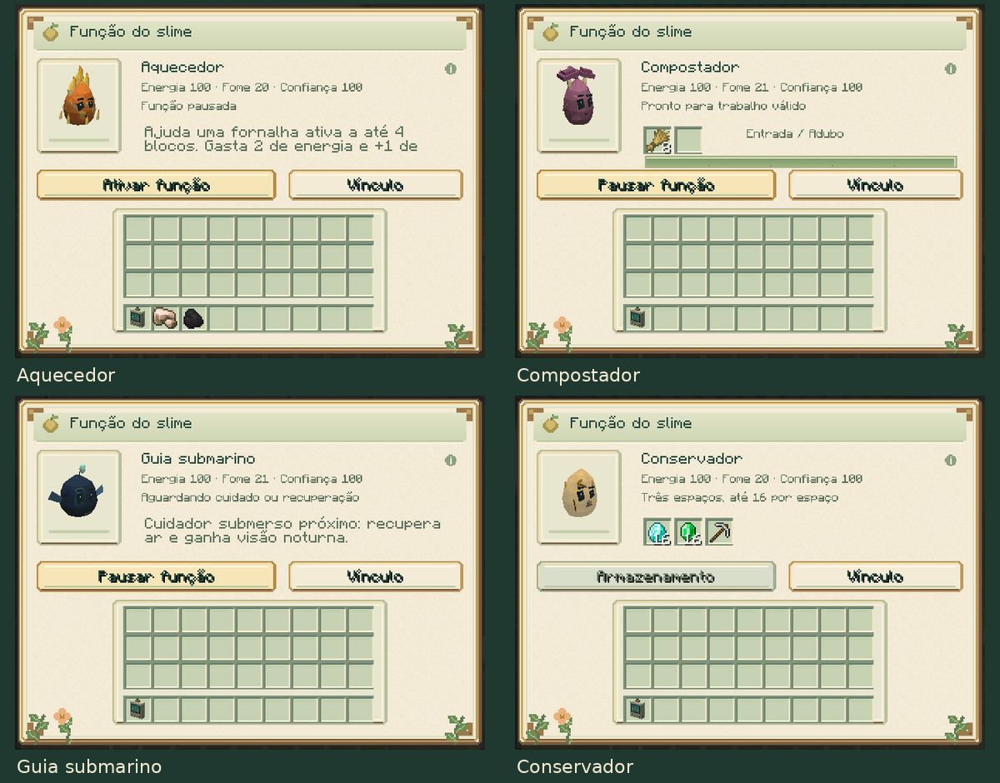

# Slime Evolution 0.9.0

[Atualizações por versão](README.md) · [Guia do mod](../README.md)

Quatro espécies ganham funções individuais, acessadas pelo novo botão **Função**
no painel de vínculo:

- **Fogo:** aquece fornalhas, defumadores e altos-fornos em funcionamento.
- **Fúngico:** transforma oito compostáveis em uma farinha de osso.
- **Abyssal:** recupera ar e oferece visão noturna ao cuidador submerso próximo.
- **Âmbar:** guarda itens em três compartimentos limitados e os mostra dentro do corpo.

Processamento e auxílio exigem ativação, cuidado e recursos. Os pertences ficam
salvos com o indivíduo, acompanham cápsulas e metamorfoses e são derrubados uma
vez na morte. O cuidador pode retirar itens mesmo com as funções desligadas
pelo servidor. Inventários incorporados e cápsulas não entram nos compartimentos.

A sétima interface reutiliza os materiais SolarPunk. Modelos e texturas das
criaturas, itens e blocos são preservados; o Âmbar passa a desenhar os objetos
guardados com os modelos reais dos itens.

[Como usar as quatro funções](../guides/SPECIALIZATIONS.md) ·
